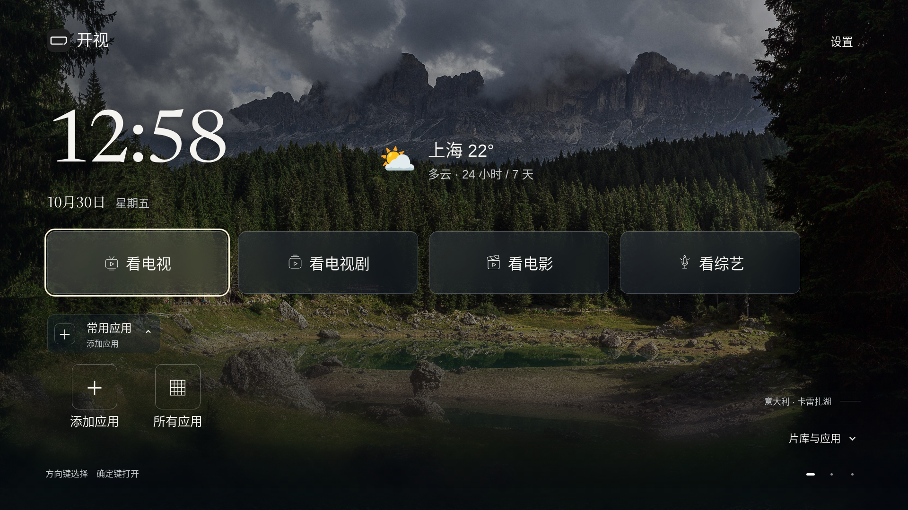
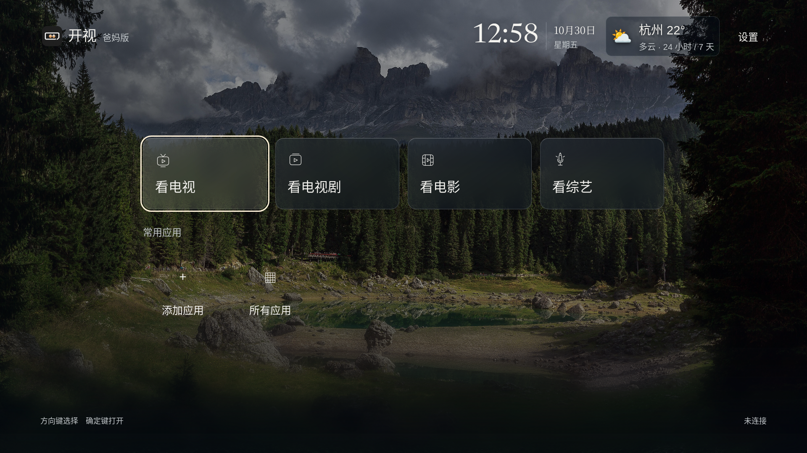
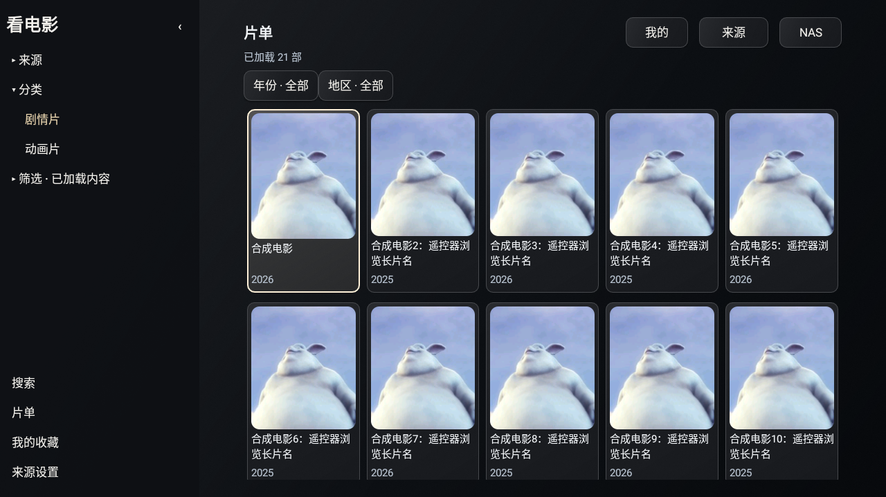
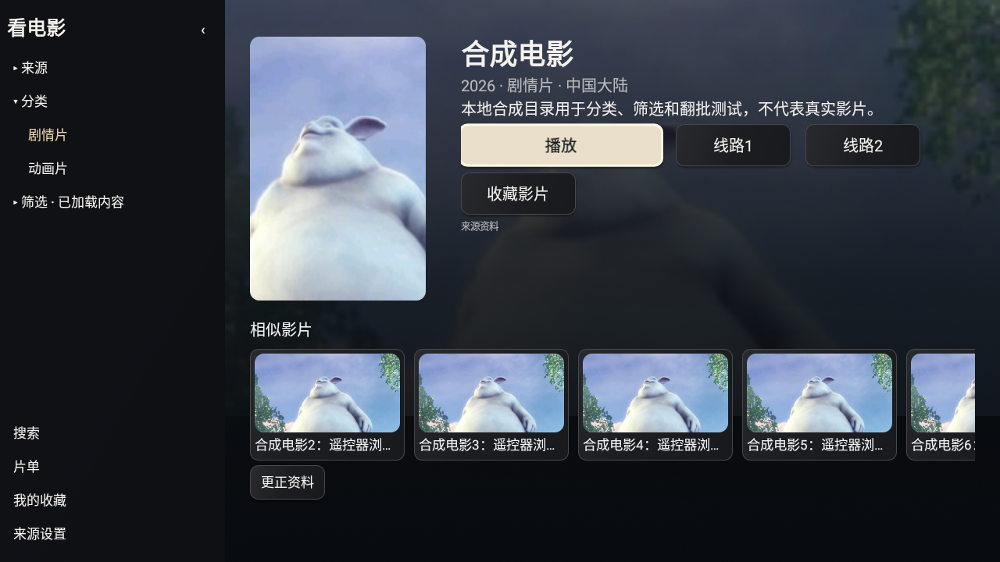

# 开视 · Aperture TV

**本项目仅适配小米电视。** Android 8+ 是最低系统要求，具体机型和固件需要实测。开视是运行在原电视系统上的家庭入口应用，不是小米官方ROM或官方认证产品。

智小策的首个开源项目，当前为 **Alpha 测试版**：保留原桌面、小爱同学与原系统账号，在电视上增加日程、留言、数据、NAS资源和可定制入口。

当前版本 **v29 / 0.2.0-alpha.26**：播放线路顺序回退、换线保留进度，片单固定五列，选集显示完整长标题。确认打开频道/选集，点播左右调进度，直播上下换台。首页返回原桌面；只读留言源由Agent更新文件。相册继续从发行版关闭。见[发行说明](docs/RELEASE-S77.md)。

**v29可更新v18—v28，保留配置；与v17并存，保留旧数据。** 从v17首次使用新包名需要重新配对、配置NAS；请先读[迁移说明](docs/MIGRATION-V18.md)。默认作为普通应用安装，HOME候选关闭。

## 两个版本

- 标准版：首屏看电视、看电视剧、看电影、看综艺、常用应用；向下进入片库与家庭分区。深色玻璃、4K摄影背景和遥控焦点。
- 爸妈版：看电视、看电视剧、看电影、看综艺，以及常用应用快捷入口。安装和来源配置留在家人设置。





## 安装与使用

按[小米电视安装说明](INSTALL.md)开始。[下载与版本](docs/DOWNLOADS.md)说明两版选择和校验方法；[Alpha测试下载](https://github.com/xiaoerdata/aperture-tv-open/releases/tag/v0.2.0-alpha.26)提供标准版、爸妈版和源码；也可[免费本地构建](docs/ANDROID-LOCAL.md)。不需要Root、刷固件或停用原桌面，默认作为普通应用启动。

直播与影视支持M3U/TXT、XML/JSON、多仓与type4播放解析；type3支持经用户确认的JAR/Dex、JavaScript/drpy和Python插件。插件兼容有边界，见[内嵌影院](docs/EMBEDDED-CINEMA.md)与[插件说明](docs/PLUGIN-ENGINE.md)；没有预置影视来源。

“我的”集中展示NAS和影视观看记录、收藏与追剧。首页摘要按已有配置显示，无数据时保持空白。[智小策Hub](docs/HUB-DISPLAY.md)预留电影、体重、旅行、账本的授权面板接口；本版尚不能扫码登录Hub。

设置里可以从文件选择器或已连接NAS选取独立APK，由原系统确认安装。SMB2/3与HTTPS WebDAV可读取家庭NAS。家庭信息、WorkBuddy和统一片库另使用自托管家庭服务。

官方Agent示例使用[WorkBuddy](docs/WORKBUDDY.md)：扫码配对后按授权更新内容；安装和卸载应用分别授权，电视开启短期窗口并保留系统确认。请求提交、等待确认与设备回执分开，不提供任意Shell、远程代码或静默安装。

## 开发

需要Node.js 22+、Python 3.10+和Pillow。按仓库现有说明设置本地环境变量，不提交私人凭证。

```bash
npm ci
python3 -m venv .venv
.venv/bin/pip install -r requirements.txt
PATH="$PWD/.venv/bin:$PATH" npm run start:checked
```

配置与家庭服务启动步骤见[部署](docs/DEPLOYMENT.md)，Android构建见[本地构建](docs/ANDROID-LOCAL.md)。系统边界见[小米兼容检查](docs/XIAOMI-COMPATIBILITY.md)，扩展见[开发说明](docs/DEVELOPMENT.md)。

工作流程与原始需求保留在[开发记录](docs/process/README.md)。历史文档中的私有下载链接统一指向[下载说明](docs/DOWNLOADS.md)，不表示历史内测包已公开。公开源码不含私人家庭数据、开发凭证、签名密钥、SDK运行目录或旧私有Git历史。

## 当前验证边界

S76两版各27条Android系统输入断言通过，另有4组首页和13组天气/屏保浏览器任务、协议/消息与服务回归。两版发行构建、签名和随包资源核验见[软件回执](docs/verification/s76-summary.json)，实际画面见[反馈处理](docs/V28-FEEDBACK-S76.md)。

测试为Android28软件模拟器；其旧WebView使用原生恢复首页。小米原桌面、小爱/米家、玻璃首页Android亮屏与OEM屏保、中文TTS、WorkBuddy实际上传、NAS硬件、外部点播成功率和两小时播放仍待维护者验收。未做SAR修正，不宣称所有直播黑边已解决。没有预置影视来源，产品继续为Alpha。

天气服务开发机连通不等于大陆电视网络验收；免费Open-Meteo API限非商业用途，见[第三方说明](THIRD_PARTY_NOTICES.md)。

问题反馈见[Issues](https://github.com/xiaoerdata/aperture-tv-open/issues/new/choose)，二次开发欢迎[Pull Requests](https://github.com/xiaoerdata/aperture-tv-open/pulls)。

核心代码使用[MIT许可](LICENSE)。字体、图片、依赖与上游连接器分别遵守各自许可，详见[第三方声明](THIRD_PARTY_NOTICES.md)。




