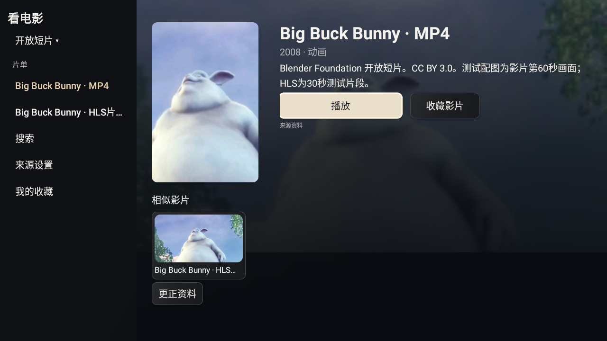

# S66 · 简单公开资源验收

按P65改用Blender官方Big Buck Bunny MP4、Mux官方同片HLS测试流、影片实际帧图片，外加自制M3U与开视片单包装。包装是测试配置，不是公共电视台或商业影视仓。原报告资源不再是本轮发布前置输入。

| 检查 | 证据 |
| --- | --- |
| 相对台标：重定向、缓存、内联TVBox、HTTP同意、坏图不丢频道 | [14项生产断言](../tests/java/CinemaLogoAddressTest.java)，先失败后修复；5组相关回归通过 |
| 资源来源、文件摘要、403失败与图片替代方法 | [来源回执](verification/s66-public-resource-provenance.json) |
| 两版原生图片/播放/收藏/进度/重复导入 | 标准版首段18项诊断后修复直播，最终直播5项通过；爸妈版首段16项后资源服务退出，媒体续测8项通过。见下方范围说明 |
| 两版发行签名、包名、版本、ABI、源码一致 | 两版构建/lint、发行证书、ARM32/64、品牌资源、76份对应class核对通过 |
| 公开源码与下载回读；旧版本保留 | v24已公开；4份完整附件与1476个Git树blob摘要核对通过，旧9次发行/9个标签/36份附件保持不变 |
| Hub名称、版本、图片、下载链接及三方门禁 | 旧展示已检出漂移，准备更新 |

本轮不证明原报告61项的90%海报命中率、原包5→10分组的准确根因、真实资料服务质量、所有TVBox插件兼容或实际频道名称/画面相符。API28 x86原生解码通过也不代表小米ARM真机；实体遥控器、原桌面、小爱唤醒、米家、NAS硬件、WorkBuddy由维护者验收。旧版的完整80项播放回归、新版的关联20项与本轮公开媒体测试分别保留版本范围，不混算。

公开资源的可访问性仅代表本次观察，不向安装包内置第三方来源。图片为影片截图而非原始海报。

## S67/S68 新增发布前检查

- 两版底部控制条不再常驻三排按钮；正常控制条不超过屏高三分之一，选项在同窗口展开。
- 播放焦点默认左右键松开跳转；暂停意图保持；Back先关闭更多。
- 电影/电视剧/综艺默认展示首个片目信息，左侧切来源/节目；直播无需先选来源或分组。
- 程序未配置来源时保持设置入口；插件信任确认不因导航简化被跳过。

以上新增项已分段验证。未使用S66旧UI候选作为最终版本。

## 最终软件范围

[软件清单](verification/s68-software-acceptance.json)、[标准版最终直播](verification/s68-native-standard-live-final6.json)、[爸妈版首段16项及资源服务中断](verification/s68-native-parents-attempt1.json)、[爸妈版媒体续测8项](verification/s68-native-parents-media-final.json)。两版设备base.apk已完整回读，与对应本地debug APK摘要一致；76份相关compiler class分别与ARM release相同。不是两版各23项的同一次全量通过，也未重跑旧v22完整80项。

样例通过主机镜像提供；MP4只前移容器索引，编码音视频不变。真实MP4推进、左右松开跳转与暂停保持、同窗口更多、收藏/记录、四区直达、HLS和台标均有原生行为证据。原报告包、全部插件、原61项命中率和小米/小爱/米家/NAS/WorkBuddy不在这次样例结论中。

截图采集与功能分开记录：部分早期尝试因UiAutomation、资源服务生命周期或短暂控件查找时序而失败，原回执保留。最终媒体续测的ADB图片成功且无captureErrors；采集前由测试驱动暂停，之后显式恢复。

本地可复现：先在一次性API28 x86 debug模拟器准备APK，运行 `python3 scripts/fetch-public-media.py`（可选开发依赖OpenCV）及 `node scripts/public-media-fixture.mjs`，记录输出base；用 `scripts/build-revision-emulator-tests.py --edition parents --suite public` 或 `--suite publicmedia` 构建独立驱动，再通过 `adb shell am instrument -w -e fixture <base> <instrumentation>` 运行。驱动仅接受模拟器debug包，会重置该测试应用配置，拒绝真实小米与release包；不混入发行APK。

本清单在发布前冻结；实际公开附件和匿名回读的发行回执将追加到主分支，不回写已发布标签。

## 发布回读

v24 / alpha.21已公开，见[发行回执](verification/public-alpha-v24.json)与[下载](https://github.com/xiaoerdata/aperture-tv-open/releases/tag/v0.2.0-alpha.21)。源码固定于 `0442ef75c844c20365dfafc57f8e5eb0b2dd7aeb`。两版APK、testing-manifest与SHA256SUMS完整匿名下载核对一致；匿名Git标签及1476个递归blob摘要匹配审阅冻结源，未将此称为完整GitHub源码归档下载。旧9次发行、9个标签与36份附件的标识及摘要元数据不变。发布回执追加主分支，不修改冻结标签或附件。
