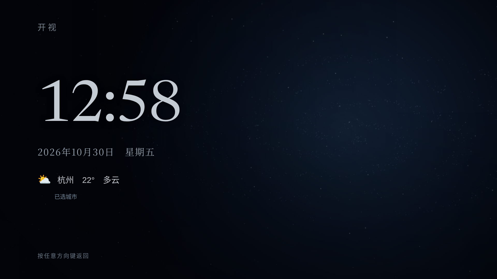
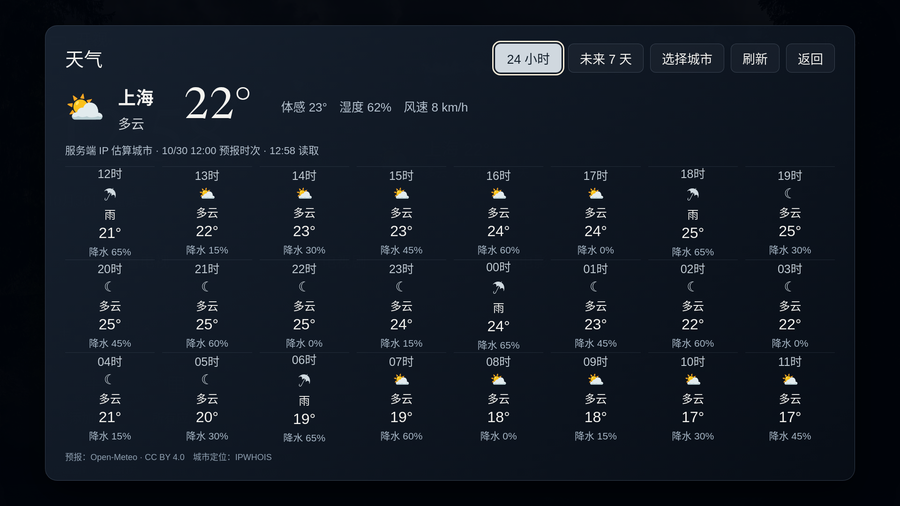
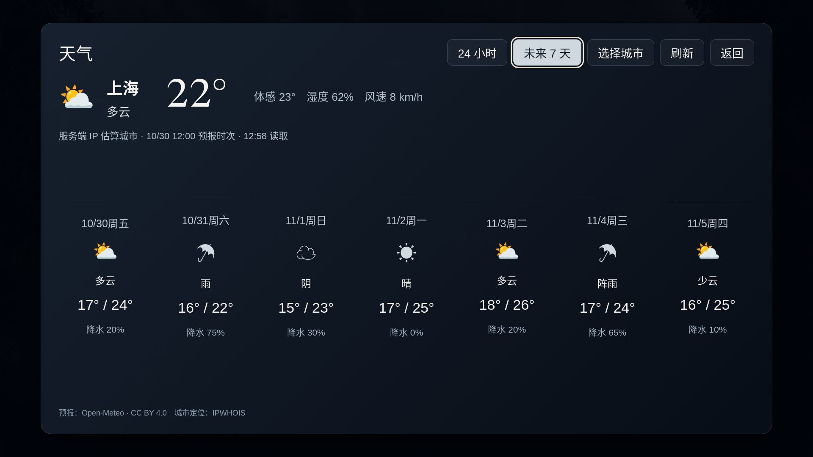

# S71 · 星河屏保与天气

本页记录S71本地开发结果；后续S72将这些功能纳入v27 / alpha.24，打包与公开状态以[发行记录](RELEASE-S72.md)和[下载索引](DOWNLOADS.md)为准。v26 / alpha.23不含本页新增功能。仅面向小米电视，Android 8+。原始需求见[P71](process/PROMPTS-001.md#p71--屏保与天气)。

## 使用

- 标准版和爸妈版首页都有天气入口。方向键选中、确定打开，直接切换「24 小时」「未来 7 天」；返回键关闭并恢复原焦点。
- 默认按当前公网出口 IP 估算城市。城市不对时选「选择城市」，输入城市名并确认；可随时恢复「按 IP 自动定位」或关闭天气。
- 天气包含温度、体感、湿度、风速和降水概率。24小时包含当前小时及后续23个小时；7天包含今天，以预报城市的时区标记日期。晴/多云的夜间时段显示月亮图标。
- 首页设置 →「屏保」可选星河、流光、静态，以及2/5/10分钟或关闭。默认首页闲置5分钟进入。方向键首次只唤醒，长按不会连续触发首页操作，松开后再次按键才导航。
- 屏保保留时间、日期、天气；使用近黑底色、低亮度星尘和缓慢粒子运动。支持减少动态效果。内容缓慢小幅位移，但不承诺消除OLED残影或提供医学意义的护眼效果。
- 屏保仅在开视首页空闲时进入；天气/设置弹窗、播放、失去应用焦点或后台状态不进入。其他应用的播放不由开视接管。
- 原生恢复首页也有「天气」「屏保」入口。完整首页的屏保设置另有「系统屏保设置」：跳转Android的系统设置，由用户选择。固件不开放该入口时提示使用首页屏保，不修改小米系统配置。

浏览器开发预览：启动项目后访问`/home`、`/home?edition=parents`；独立屏保为`/launcher/ambient.html`，独立天气为`/launcher/ambient.html?panel=weather`。浏览器入口不是小米电视安装验收。

## 数据与隐私

原生APK通过电视上的`WeatherProxy`直接请求天气，无需启动电脑家庭服务。浏览器开发页通过同源Node服务转发：**原生估算电视公网出口城市，浏览器估算服务端公网出口城市**。界面显示这一差别。代理、VPN、运营商出口可能导致城市不准，手选城市可修正。不支持输入任意第三方IP，也不使用GPS或小米账号定位。

固定HTTPS提供方为IPWHOIS（`ipwho.is`）、Open-Meteo预报与城市搜索。只发送查询所需的城市或经纬度；上游可见请求出口IP，不转发家庭登录Cookie或Agent令牌。IP定位结果返回前剔除原始IP字段。当前选择和天气缓存在设备本地，不写入家庭业务资料。

IP定位缓存6小时，预报/搜索缓存10分钟；页面前台每30分钟尝试更新，后台取消请求。超过30分钟的缓存或超过2小时的预报时次标记过期；首次载入不接受超过24小时的本地缓存。断网显示不可用或明确标记上次预报，不补造数值。

服务端缓存最多32项、4个并发且相同请求合并，每客户端天气路由30次/分钟；原生缓存32项、并发最多4个。单次超时8秒，响应最多512000字节，拒绝重定向、任意URL、重复坐标和越界参数。原生请求限定在已打包页面的本地HTTPS源，无JS原生桥。

## 提供方与授权

天气数据：[Open-Meteo](https://open-meteo.com/)，[CC BY 4.0](https://creativecommons.org/licenses/by/4.0/)。界面保留署名；本项目将天气代码转换为中文、温度四舍五入并选取24小时/7天显示，原始预报由提供方生成。

当前使用无密钥的公开API。Open-Meteo[价格与条款说明](https://open-meteo.com/en/pricing)将免费API限于非商业用途，公开页列出10000次/日且无可用性保证；数据CC BY授权与API访问条件是不同事项。商业集成须采用合适的API计划或替换提供方。IPWHOIS[文档](https://ipwhois.io/documentation)列出免费端点1000次/日/客户端IP，额度以提供方最新条款为准。没有将第三方API许可改标为项目MIT。

开发机实查三个接口成功，预报返回168小时/7天并含昼夜字段，见[接口回执](verification/s71-provider.json)。中国大陆各运营商、电视证书/WebView与提供方可用性未实机验证。定位/查询失败可手选城市后重试，网络不可达仍需要恢复连接，不宣称国内服务保证。

## 实现与验证

首页和Android Dream共用`ambient.html`、`ambient.js`、`ambient-scene.js`、`weather.js`及模型。Canvas原创程序绘制，约15fps，固定1280×720绘制缓冲、240个移动粒子、1700个预绘星尘点；不嵌入视频或新依赖。4K布局仍使用该绘制预算，没有实测电视帧率或GPU占用。

Android新增可选DreamService（受`BIND_DREAM_SERVICE`保护）及非导出的独立页面Activity。没有申请麦克风、Root或系统设置写权限。小米固件是否允许选择、定时启动及语音唤醒，仍须真机验收；首页空闲屏保不依赖系统Dream开关。

- [浏览器13组任务](verification/s71-browser.json)：两版、960/1280/1920/3840布局、24h/7d、城市持久化、唤醒重复键、实际空闲计时、后台停止、断网、独立页返回与动态Canvas。
- 5组Node/JVM测试通过，含15项生产Java传输断言；两版Android 35 API定向编译和已有原生兼容策略检查通过。
- [源码绑定及边界](verification/s71-summary.json)。未构建APK、未运行小米真机或Dream服务，没有推送或发布。

复现（本机需已有浏览器、JDK、Android API及依赖路径）：

```bash
CHROMIUM_PATH=/opt/google/chrome/chrome node scripts/browser-s71-ambient-qa.mjs
node --test tests/weather.test.mjs tests/weather-native.test.mjs
node scripts/check-native-compat.mjs
```

截图为实际浏览器页面，**天气是合成测试数据，不是真机或实时气象实况**：







流光与手机回退：[流光](images/s71-saver-flow.png)、[手机](images/s71-weather-mobile.png)。记录与传播底稿见[日志](process/JOURNAL.md#s71--星河屏保与天气)、[第52期](../media/DEVLOG-052.md)。
