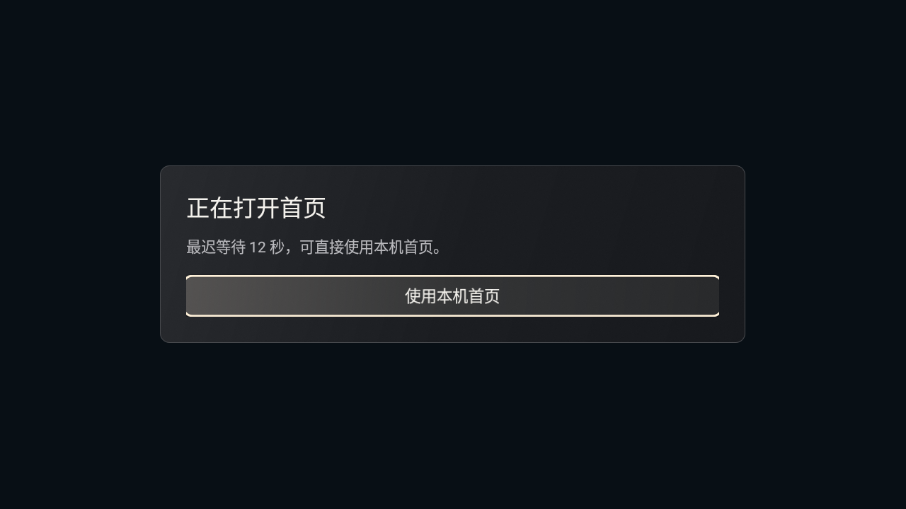
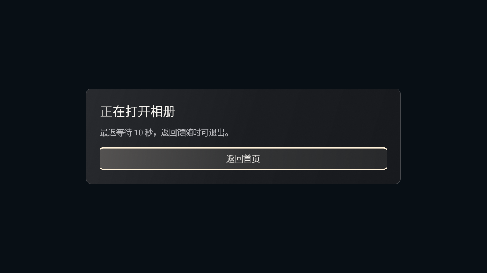
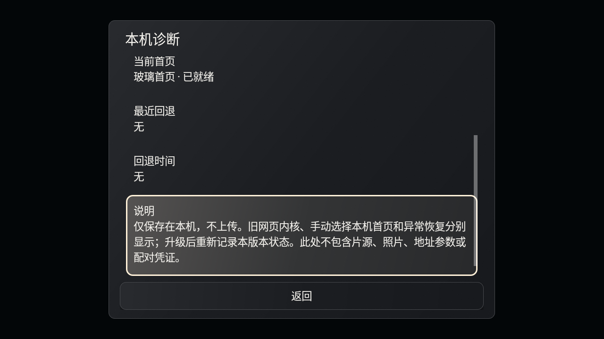

# v37 标准版候选 · Round 1

`0.2.0-alpha.34` / versionCode37，源码基线为已发布 v36 的 `72d24b47d81d7edc6ce41d426a892df481385da2`。仅标准版；爸妈版暂停。本轮是本地候选，不公开推送、不更新 GitHub Release，等云端复测后决定下一轮。

> 最终候选输入为 `33756c70ba3c2295ed6f78efe65f52bdd2e4829786803a4bc797e6ac3d82b0fb`。协调方先收到的 `5cd654930eb490d2dde05b18143aa5237128ae4588bc06ca106136b248ae3515` 及其两包已失效为最终候选；新增的唯一产品源码差异是 MainActivity 失焦时暂停期限。精确增量patch与新两包SHA随交付manifest提供。旧输入的48项探针结果单独保留，不能直接当最终输入的全矩阵通过。

## 证据与归因

协调消息提供的云测环境为官方 API30 x86 / WebView90，无 KVM、1vCPU、3GiB、1280×720。v36 主页面加载后白屏数分钟，随后 Trichrome `libmonochrome.so` 出现 `SIGILL/ILL_ILLOPN`，`onRenderProcessGone` 更晚收到；另有 FocusEvent 超时与系统商店 ANR，未使用片源。这里保留为**外部提供的测试事实**，本机没有重现该 SIGILL，不能据此认定产品缺陷、内存不足或声称引擎崩溃已修复。

本轮处理已确认的源码恢复缺口：启动期限此前依赖 `onPageFinished` 才检查，相册也缺少渲染退出/超时处理，且 Back 需要等待 JS 回调。源码缺口与实测崩溃分别记录。

## R1-01：首页加载与恢复

原生深色加载面板显示“正在打开首页”，可直接选择本机首页。`PageDeadline` 在前台累计 12 秒等待预算；每次创建页面分配绑定该 WebView 对象与导航代次的 ticket，成功、取消、销毁时撤销计时。后台或窗口失焦时暂停预算，回到前台且窗口获得焦点后继续剩余时间；旧回调不能移除新页面或恢复已经退出的旧页面。

文档结束后检查两个必要的 JS 入口；缺失时有限检查三次、间隔250ms，随后进入本机风景首页。不依赖文档结束回调才能超时，JS求值不回调也受同一期限限制。主文档错误与 renderer-gone 各自记录固定原因；异常后本次 Activity 不自动重试网页，不循环 reload，不清配置，不绕过 WebView89 的门槛。用户主动取消加载单独处理。

12秒是离线首页的交互恢复预算，旨在避免数分钟等待；**不是测得的启动性能分位数**。Handler 依赖主线程可运行，无法在主线程/系统已经卡死的 ANR 中保证严格墙钟期限；此次没有修复官方 Trichrome 的非法指令或操作系统问题，仍需云测。

## R1-02：相册恢复与返回

相册有原生加载状态和10秒前台预算，检查自身JS入口，主文档错误、初始化失败和renderer-gone进入有原生返回按钮的失败页。Back 在加载/失败时直接原生返回，正常页先给全屏轮播关闭机会；JS不回调时600ms后原生退出，重复Back立即结束，迟到回调无效。后台取消Back等待、暂停加载预算，恢复后只延续当前页面；没有自动reload。

清理先从父容器detach再destroy。已退出的renderer不调用stopLoading、暂停或JS。退出/后台/失败关闭本Activity的上传会话，不自动开启HTTP服务。本轮故障探针没有开启真实上传窗口、没有读用户照片；相册上传协议和socket的既有v36测试不能替代本轮真实手机或云端验收。

10秒同为本地相册恢复预算；600ms为Back的有限JS等待，不是模拟器性能承诺。已保存照片、模板和偏好不由失败恢复清除。

## R1-03：只读诊断

标准版设置末项“本机诊断”显示应用版本、系统实际WebView提供包/版本、当前首页模式、最近回退原因与时间。模式区分正常网页、加载中、旧内核策略、用户选择和异常恢复。记录固定原因枚举，不存URL、查询参数、sharecode、照片或令牌，不后台发送。每个版本独立记录；升级只重置诊断记录，不清其他配置。

内容为可聚焦、可滚动的原生文本，方向键可到达中文长说明。结构化 `KaishiWeb` 日志只含 versionCode/screen/event/generation/reason。故障注入使用的合成sharecode不应进入日志。

## 验证

- [确定性时钟检查](verification/s94-recovery-unit.json)：26项deadline检查，加9项生产DisplayLifecycle/deadline模块组合焦点检查；原有4组首页路由检查通过。模块组合检查不执行Android Activity适配层。
- [先前输入的Activity故障注入](verification/s94-recovery-native.json)：绑定旧输入5cd654，Android28自有隔离模拟器48项。运行真实MainActivity/GalleryActivity和原生组件，WebView回调由受控测试替身注入，首页选择门槛在测试子类中设为90；不是实际WebView90、不是实际杀renderer或小米真机。
- [脱敏日志](verification/s94-diagnostics-log.json)：检查日志字段白名单与合成敏感字符串不出现；纯本机记录。
- [本地升级状态](verification/s94-upgrade.json)：**未取得通过结果**。初始数据盘未进入框架就绪；后改只读运行overlay，在其中移除旧开发fixture后，框架仍未稳定就绪。按协调更新停止环境等待和重建，保留失败，不改真实设备。原测试磁盘大小/mtime核对未变。云端将用自身既有debug证书独立做升级验证。
- [最终候选验证边界](verification/s94-validation-scope.json)：焦点修复新增3项Activity注入用例已编译、未执行；[javac回执](verification/s94-focus-probe-compile.json)记录重名变量修复后的实际exit0，首次失败日志保留；最终输入的完整矩阵、API30/WebView90和升级均待云测。

## 候选与复建

ARM32/64候选用于后续小米测试，x86候选仅用于云端API30模拟器。二者210项Android与launcher源码输入相同，ABI参数分别为默认ARM双架构和 `-PkaishiAbis=x86`，没有把测试替身或故障注入入口打进产品APK。沿用既有发行签名，无新建签名身份。

从候选源码运行既有 Gradle 8.9 / JDK17 / SDK35 工具链：`:app:assembleStandardRelease`；x86加 `-PkaishiAbis=x86`。Gradle的offline选项不等于Python pip绝不联网：已固定的Chaquopy依赖可能从官方索引读取缓存或下载相同版本，本轮没有新增依赖或更改网络安全策略。签名工具 `scripts/s94-sign-candidate.py` 只接受外部现有密钥环境变量，不生成密钥、不上传。

最终本地候选提交、包SHA-256、源码精确patch和构建清单统一写入候选目录的 `ROUND1-MANIFEST.json`；公开的v36附件保持不变。

## 仍需云端复测

使用x86候选在同一API30/WebView90环境：真实正常启动、无文档结束或JS回调时可见恢复、后台/返回、诊断字段与日期、相册正常/空状态和失败返回。记录CPU/调度与系统ANR时，区分Handler无法运行和网页加载超时；不要据本机受控探针推定SIGILL根因。

小米85 QLED默认显示、HOME/原桌面交接、小爱/米家、照片手机上传、守护接管和真实网络资源均未测试。主页已ready后的 `apertureBack` 等待仍沿用旧路径；本轮600ms原生Back兜底仅适用于相册，可作为下一轮具体反馈项。完成此候选后停等云复测，不自动递增v38/v39。
