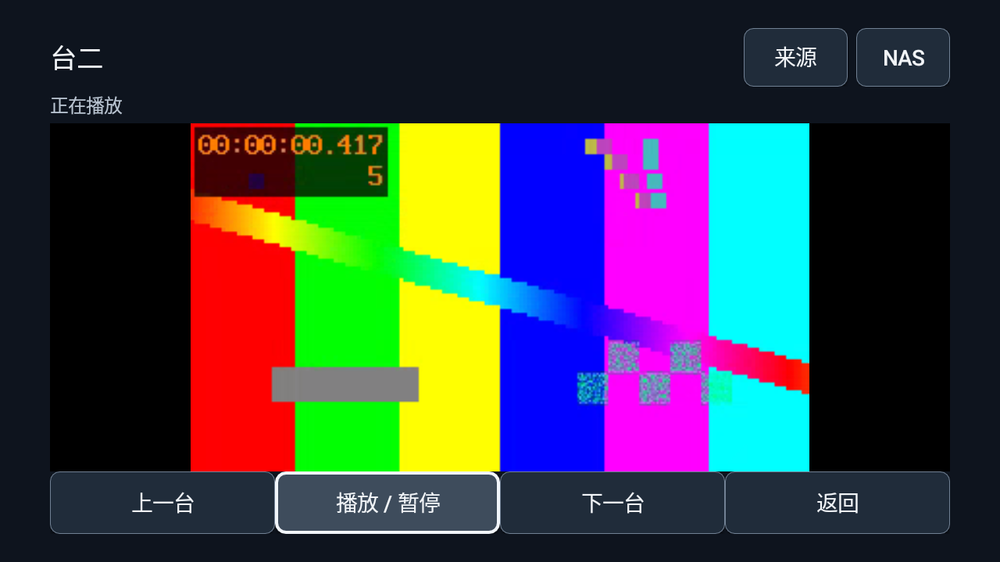
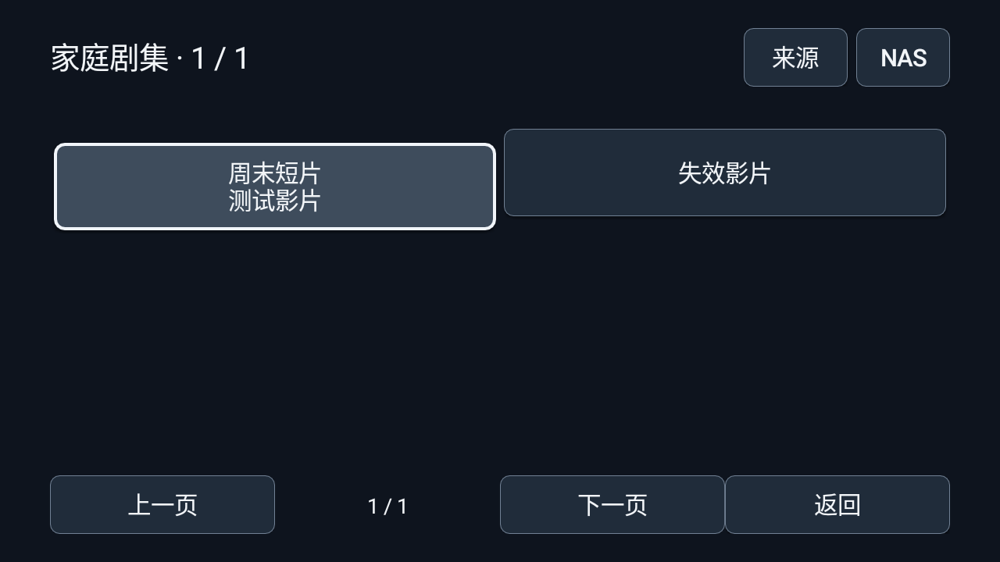

# 开视内嵌直播与影视

以下能力对应S50 / v17候选；发布与测试状态以[下载说明](DOWNLOADS.md)为准，文末保留各阶段历史证据。

仅适配小米电视，Android 8 / API26 起。正式中文名为开视。本轮将直播、站点目录、选集和播放器加入 APK，不依赖外部 TVBox 或影视仓应用启动；仍保留用户已有应用的独立入口。

## 电视怎么用

1. 从[下载说明](DOWNLOADS.md)选择 v17 / 0.2.0-alpha.14 对应版本，保留同签名覆盖升级，不先卸载。
2. 设置 → 直播与影视来源。可输入自己维护的 JSON/XML/M3U/TXT 或多仓地址，或使用系统文件选择器导入配置。系统无文件选择器时使用配置地址。
3. 查看导入数量与不支持项，确认后替换本机来源。需要 HTTP 地址时明确勾选允许；默认按 HTTPS 导入。示例见 [配置样例](../examples/tvbox-compatible.json)，其中 `.invalid` 域名必须替换，未内置真实频道或影视源。
4. 标准版：直播 → 直播频道，影视 → 影片与剧集；外部应用作为单独可选项。爸妈版的看电视/看电视剧/看电影使用内嵌模块，来源配置在家人设置。
5. 直播按来源、频道组选择频道，支持上一台/下一台及多线路选择。影视按站点、分类、搜索、片目、线路和选集浏览；可以切集、暂停和快进/后退。

来源接入不要求电脑家庭服务在线。NAS 按钮保留原生直连，爸妈版已绑定的电影/剧集 NAS 路径继续由 NAS 入口使用。Jellyfin 与原家庭服务片库可从来源设置里的“家庭服务片库”进入；它们仍使用原家庭授权，不混入第三方站点凭证。

看电影和看电视剧目前是两个观看入口，进入后按站点提供的分类选择；没有自动识别并强制过滤片目类型，没有跨站搜索或统一海报墙；本机NAS和内嵌影视共用观看记录。

## TVBox 格式兼容范围

| 输入 | 本轮支持 | 边界 |
| --- | --- | --- |
| 标准 M3U / TVBox TXT | EXTINF/group-title、TXT的`分组,#genre#`、名称/URL、多线路、相对地址 | 每频道最多8线、总500频道；字面`$`须URL编码，`$`后按线路别名处理 |
| TVBox lives | 内联channels/name/urls、远程M3U/TXT、直接HLS/MP4媒体地址 | HTTP(S)；不支持proxy/UDP/P2P或直播脚本 |
| MacCMS XML / JSON | 分类、分页、搜索、详情、直接API地址 | XML使用ac=videolist，JSON使用ac=detail；XML拒绝DTD/实体 |
| TVBox sites type=0/1/4 | XML/JSON目录；type4的play/flag/extend解析接口 | 播放结果需返回HTTP(S)媒体地址；parse/jx网页嗅探另有边界 |
| 多仓 | urls/name/url、data/sourceName/sourceUrl | 先选择配置，最多三层；保存的是选中子配置 |
| 请求头 | header/headers、ua/referer、URL竖线头、EXTVLCOPT | 限制头名称、长度与数量；多线路分别保留各自头 |
| vod_play_from / vod_play_url | 多线路、集名、HTTP(S)媒体直链 | 明显网页播放页跳过；无扩展名交播放器验证，接受地址不等于可解码 |
| type=3、spider | 经信任确认执行CatVod JAR/Dex、JS模块和Python Spider | 详见[插件引擎](PLUGIN-ENGINE.md)的运行契约与限制；不保证任意TVBox插件 |
| parses / 网页解析 | 不执行 | parse/jx结果明确提示换直连线路；没有隐藏网页广告或DRM绕过 |

配置最多512KB，最多12个影视站点与12个直播来源；目录每批最多120项、分页最多500页、影片最多20线路/合计500集。不提供现成影视源；用户自行配置。未实现筛选扩展、海报墙、字幕/音轨切换、DRM、自动下一集和自动故障切线。实际解码依赖电视。

## 观看记录、收藏与追剧

“我的”包含最近观看、收藏频道、收藏影片、收藏 NAS、追剧。播放器支持收藏、重试、从头播放，片目详情支持续播和追剧；记录保存来源/片目/线路/集名，重开时重新取详情，不缓存可能失效的媒体直链。播放期间每15秒及暂停/退出保存进度；已看完不跳到片尾。来源已移除会提示重新配置，不自动转到同名片目。

记录最多200条，用本机CinemaVault独立AES-GCM加密。清空观看历史保留收藏和追剧；容量满优先淘汰未收藏/未追剧旧记录，全部受保护时拒绝新增而非静默丢弃。记录读取失败不覆盖旧文件。追剧由用户在前台按“检查更新”，每轮最多12项、25秒，失败保留旧信息；没有后台推送。

本机NAS通过连接UUID和相对文件路径进入同一记录库，不保存NAS密码或临时媒体地址。继续观看会重新验证连接、允许的目录和文件是否存在；移除连接后明确提示。两个Activity每次都在共享锁内读取最新加密记录并只应用本次修改，避免旧快照覆盖另一模块的收藏或进度。Jellyfin与电脑家庭服务的观看数据仍独立，不宣称云端跨设备同步。

## 内部结构

- `CinemaCatalog` / `CinemaFormats`：数据校验、TVBox兼容子集、M3U/TXT/XML/JSON与选集解析。
- `CinemaHttp`：有界请求、分类/搜索/详情、媒体样本检测。目录请求最多跟随三次重定向，逐跳校验，跨源丢弃凭证和自定义头，不执行配置中的代码。
- `CinemaCipher` / `CinemaVault`：独立AES-GCM记录和AndroidKeyStore密钥；不复用NAS密钥或放大NAS记录限制。规范化后再次限制512KB，失败不覆盖旧配置。
- `CinemaPlugins` / `CinemaJsPlugin` / Python runtime：外部插件的摘要固定、信任、执行与撤销；导入配置不自动运行插件。
- `CinemaActivity`：原生浏览、来源设置与MediaPlayer播放，非导出Activity；复用PlaybackSession、PlaybackAudioFocus和DisplayLifecycle。失去窗口或音频焦点暂停，小爱结束后不擅自续播。
- `MainActivity`：玻璃/简洁首页统一路由；原生播放器不要求WebView89。原家庭服务Web播放器仍保留自身内核要求。

没有新增Android权限或后台服务。为兼容用户明确导入的HTTP媒体，v15应用的cleartext标志改为true；家庭服务和NAS的原有HTTPS校验没有放宽。HTTP开关校验的是导入及目录请求地址；平台MediaPlayer自行处理播放重定向、HLS分片和CDN，当前不能声称所有后续请求均受同一域名或HTTPS限制。配置和URL中的站点参数只保存在本机加密记录，不发送到首页WebView、Hub或日志。

## 来源检查

保存后自动启动一次；模块保持前台时每15分钟再次检查，不作为常驻后台服务。手动入口为来源设置 → 检查来源。每轮最多12个来源、25秒整体网络预算，轮换起点；没检查的来源明确显示“本轮未检查”。返回、改配置或退出时取消旧任务，旧结果不写回。

XML/JSON影视检查分类/片目结构，直播检查来源清单与首个频道的有限样本。可执行插件标注“按需检查”，后台检测不触发下载执行或授权对话；用户进入站点后验证目录。分别显示目录可读取、清单/媒体样本可读取或不可读取；检测不会自动删除、替换或切换频道，也不等于整片、全部频道、HLS分片/密钥和电视解码验收。检测结果当前只保留在模块会话中，不提供长期健康历史。

## 人与 Agent

人类任务流：导入预览 → 明确保存 → 目录/频道 → 选集 → 本机播放 → 遥控返回。数据校验与播放意图分离，导入来源不会自动播放。

本轮没有新增MCP工具。WorkBuddy原有家庭编排、NAS交接和应用管理保持原范围，不能用旧令牌隐式配置新影视来源。后续拟提供独立 `media.sources.configure` / `media.catalog.read` / `media.play` 能力，复用本机校验与执行端；加密交接、来源版本、幂等、撤销和实际播放回执须完整实现后再开放。当前不发布新Skill或将规划项加入工具发现。

## 参考与许可

核查了TVBox分支 [takagen99/Box的配置解析](https://github.com/takagen99/Box/blob/main/app/src/main/java/com/github/tvbox/osc/api/ApiConfig.java)、[站点请求与播放结构](https://github.com/takagen99/Box/blob/main/app/src/main/java/com/github/tvbox/osc/viewmodel/SourceViewModel.java) 和 [LICENSE](https://github.com/takagen99/Box/blob/main/LICENSE)。该分支许可证为AGPL-3.0。本轮自行实现数据接口兼容，未导入其源码、二进制、图标或播放器；开视现有MIT许可不因参考协议而改写，也不将AGPL代码改标MIT。

GitHub连接器本轮传输失败，部分旧仓库/路径404，匿名API限额403；随后通过公开raw文件读取以上实际源码与许可证。来源及摘要见 [研究记录](verification/s46-tvbox-research.json)。不可用的FongMi/TV与旧TVBox地址不作为已经读到的证据。

## v15早期验证与包（历史）

生产Java解析、OkHttp请求与AES-GCM使用隔离本机HTTP站点验证，36项断言通过，见 [协议记录](verification/s46-embedded-cinema.json)。覆盖新旧格式、规范化、M3U/HLS区分、分页/搜索/详情、解析需求、篡改、大小/数量限制、HTTP授权、重定向、HTTP200网页和整体请求时限。两版API编译、旧原生策略与首页浏览器回归通过。

一次免费本地双版构建通过，Gradle29秒、66任务（26执行/40复用）。本地测试包在 `artifacts/kaishi-v15/standard/kaishi-v15-standard-debug.apk` 与 `artifacts/kaishi-v15/parents/kaishi-v15-parents-debug.apk`，同目录有manifest、签名与SHA256SUMS。签名/包名与v14及v13一致，versionCode15；完整输入与包内容检查见 [APK记录](verification/s46-v15-candidates.json)。工作区未提交，明确dirty=true，不称为干净提交的发行构建。

没有运行新增Activity、AndroidKeyStore或实际MediaPlayer，也没有小米电视解码/小爱现场验收；API编译与HTTP样本不代替这些结果。本轮没有新的原生播放器截图，不以首页浏览器菜单画面冒充播放器实拍。公开下载仍为v13，未推送或更新Release。

## S47 · v16软件验收

两版API26模拟器完整流程通过，见[软件验收](verification/s47-software-acceptance.json)、[标准版](verification/s47-native-standard.json)与[爸妈版](verification/s47-native-parents.json)。验证实际配置导入、AndroidKeyStore加密与v15→v16保留、H264/AAC MP4和MPEGTS HLS的播放时钟及SurfaceView彩色画面、切台/跨页选集/seek/返回焦点、真实AudioManager打断与不自动续播、失效影片、离线与HTML误报、取消清除和恢复联网。v16修复了换台和选集返回位置丢失，以及错误后prepared标记未清除。

测试驱动准备阶段读时长错误、一次导入超时、模拟器缺SSE4.1导致的系统解码器SIGILL，以及弹窗后的测试按键时序问题均留存。使用同一H264/HLS样本完成复测，没有以浏览器WebM代替原生解码。软件模拟器不代表小米固件、小爱唤醒、米家、WorkBuddy客户端或长时间性能验收；这些由维护者测试。

## S49定向验证

[生产Java解析/HTTP与记录模型](verification/s49-embedded-cinema.json)共70项断言；包括跨源凭证清除、多线路头隔离、XML实体拒绝、多仓、续播身份隔离、清历史保留收藏、已看完状态与追剧未读计数。两版API编译通过，不是APK构建。没有重新运行本轮新增Activity、KeyStore、MediaPlayer或小米真机，不能复用S47结果当S49设备通过。
