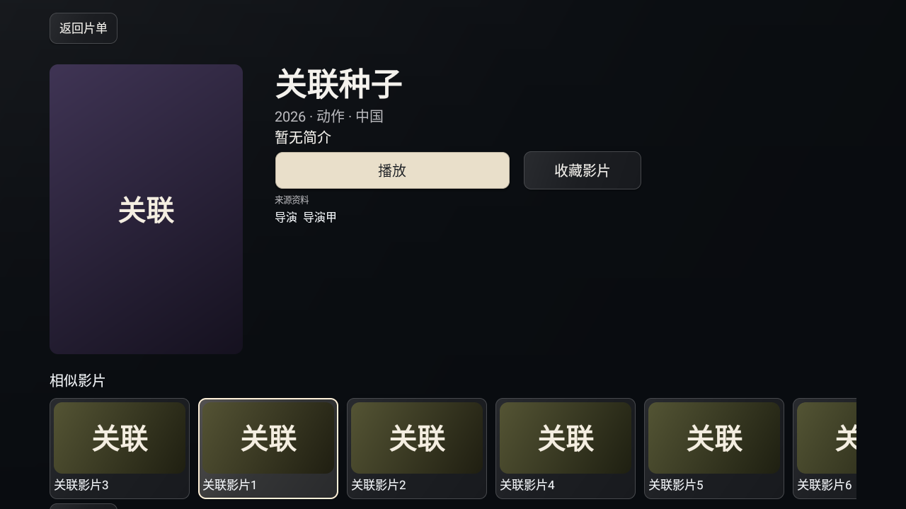
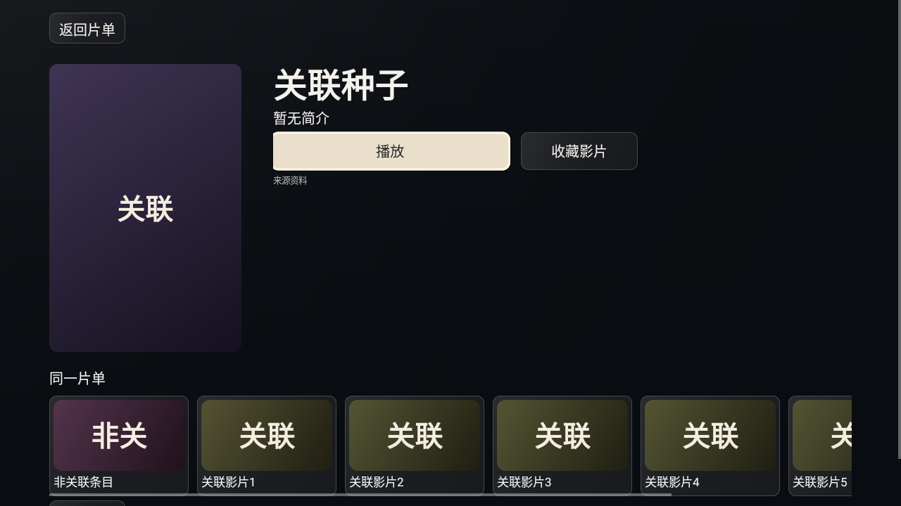

# S64：按原报告核对验收

本清单沿用P63和“确保所有的测试建议修复完成，并且正式发布”的既有目标。v22 / alpha.19已经发布；本轮源码为v23 / alpha.20发行候选。发布成功不等于全部验收。用户两份PDF的文件摘要见[输入记录](verification/s60-report-inputs.json)，原PDF未复制到公开源码。

## 验收项与证据

| 编号 | 必须证明的行为 | 当前可用证据 | 尚缺的证明 |
| --- | --- | --- | --- |
| D01 | 播放中频道侧栏、预览/确定/取消、数字键、5秒关闭、分组与EPG | v22两版各40项[原生回归](NATIVE-REGRESSION-S62.md)，真实MediaPlayer和合成XMLTV | 原报告频道与小米实体遥控器 |
| D02 | 资源包能够携带并读回封面、简介、演职员、编号、台标和EPG | [生产解析/缓存测试](verification/s62-domain-tests.tap)；v20已有metadata，v21增加别名 | 原片单是否实际提供图片、图片可达性与联网补资料的真实结果 |
| D03 | 时间轴、当前/总时长/缓冲、方向键预览与确定、暂停意图、集数/切集、直播不显示点播条 | v22两版原生回归；[浏览器实际解码](verification/s60-cinema-browser.json)；生产时间步长/长按/格式断言 | 小米真机拖动、NAS真实解码与观看距离 |
| D04 | 整份替换来源；重复导入不追加；不丢收藏和旧ID | v22原生加密导入；Java验证5组原生+5组相同TVBox包装仍存10身份、显示5组 | 报告原包未取得，不能确认当时5→10的根因 |
| D05 | 电影/剧集/综艺副标题单行省略，无半个字符裁切 | TextView省略与真实卡片宽度；S60浏览器截图 | 报告原长文案的小米截图 |
| D06 | 失败不会被暂停提示覆盖 | v22真实503媒体错误后再点播放/暂停，保留错误 | 原报告故障源，以及系统解码器特有错误 |
| D07 | 常用应用默认展开，显式折叠持久化，翻屏临时折叠不改偏好 | [首页交互回执](verification/s60-home-browser.json) | 小米首页实测 |
| D08 | 1080p入口约97–108高、应用图标64以上；各分辨率无碰撞 | 230×104入口、68图标；540p/720p/1080p/2160p与爸妈版浏览器检查 | 真实电视3米视距 |
| D09 | 主要播放动作唯一，其他线路有明确选集/线路名称 | v22原生单集电影；单一主动作与剧集切集流程 | 原报告多线路详情 |
| D10 | 失败一次Back退出；详情返回保留列表位置 | v22两版原生错误返回、第二页焦点恢复 | 小米实体键的设备回归 |
| D11 | 搜索空态与来源配置空态分开 | S60浏览器与生产文案；实际接口返回语义保持 | 原报告采集站的真实搜索结果 |
| D12 | 来源画面与频道名一致 | 应用保留来源标识和切换，不以台名推测真实内容 | 原包、来源作者与用户抽测；不是HTTP成功或台名能证明的性质 |
| D13 | CCTV6等频道覆盖 | 增补报告称作者已在资源包revision2补入CCTV6两路 | 尚未独立取得该包；不向产品内置第三方频道 |
| D14 | 家庭页减为照片/安排/留言；首页摘要只使用已配置数据 | S58减法、S60配置摘要与布局检查；未配置时不轮播 | 实际家庭配置与用户的显示偏好 |
| T-01a | 原61项开启联网资料后至少90%有封面 | 支持来源封面优先和可选联网补资料；仅有合成提供者测试 | 原61项片单、用户可用的真实资料服务与图片网络；不能填一个虚构命中率 |
| T-01b | 无图显示片名首字与稳定底色，替代统一梯形 | 原生CinemaPoster与浏览器卡片已实现；v22合成截图 | 原片单关闭联网后的真机画面 |
| T-02a | 实际背板覆盖屏高至少70% | v22实际bitmap alpha255、74%高度与原生截图 | 有来源图片的真实片目 |
| T-02b | 主播放入口恰好一个 | v22原生断言和主按钮焦点 | 原多线路资源回归 |
| T-02c | 至少三项事实元信息 | v22合成资料有年/类型/地区三项，来源事实优先 | 原片单的事实数据；资料不足时不编造时长、评分或演员 |
| T-02d | 至少六张真正相似的可用影片、最多30张、遥控可达并能返回 | v22仅证明29个同片单条目，并未证明相似性；本轮补生产元数据关联，14项断言与两版各10项原生任务流通过 | 原片单是否有足够真实关联资料 |
| T-02e | 普通详情不出现“联网资料未开启” | v22两版原生页面文案检查 | 用户真机复核；设置仍应准确显示联网状态 |

## 本轮补充

EPG连续失败缓存：直接编译生产CinemaEpgLoader/CinemaHttp/CinemaEpg，使用真实本地HTTP、两次503和实际30秒TTL。16项断言通过，包括缓存前不再请求、到期后200恢复、部分结果保留、同一请求交接最新回调、关闭不再回调。实际等待30327ms，见[完整回执](verification/s64-epg-loader.json)与[TAP](verification/s64-epg-loader.tap)。Handler/Looper是测试专用回调队列，未替换网络、EPG解析或时间；这不是Android运行、前台30秒刷新时钟或真机证明。

相似影片：只在同一可用来源内，按来源已声明的类型、导演、演员作确定性关联，不调用新的外部服务。没有资料或没有关联条目时，保持“同一片单/同一来源”的真实含义；不拿同年份/同地区作为相似依据，不以占位值制造关联，不补足虚构六张。最多30张，同证据保持原来源顺序，当前ID与重复ID排除。v22尚不含这次修改。

## 采用与边界

报告中有两处需要与源码区分：v20的嵌套metadata已能承载资料，不能直接接受“格式完全装不下”的根因；61项海报也不能因采集站能加载就断言外部图片地址全部可达。相似推荐不能用“同源数量够多”替代。报告中的有条件缩略图预览与双路画中画未宣称完成，当前提供目标时间以及台标/节目预览。

CCTV6、父类空分类、18条单集错标、56条多集错标电影，在增补报告中由资源作者声称已修正并通过strict校验。这是作者报告的外部修正，不是本仓库独立验收，更不是应用内新增频道。

当前总目标仍未证明完成：需要原报告资源包完成D02/D04/T-01a等的真实复现，以及维护者的小米电视/小爱/米家/NAS/WorkBuddy验收。源码候选、模拟器和公开发行分别记录；不修改旧发行附件来补写结果。

## 新关联原生结果

[标准版](verification/s64-native-related-standard.json)、[爸妈版](verification/s64-native-related-parents.json)各10项通过，[源码/已安装debug APK/驱动/截图绑定](verification/s64-native-related-binding.json)。API28 x86模拟器实际运行Activity，检查六张关联、证据排序、无关条目排除、主播放焦点、左右浏览、点开、Back恢复原列表、缺资料回退。本轮没有播放媒体；不能替代v22两版各40项播放回归，也不声称在v23重跑了完整80项。

爸妈版首轮主机进程SIGTERM，设备回执记录最终截图时UiAutomation断开，即使10项断言已执行也保留为[失败记录](verification/s64-native-related-parents-interrupted.json)。确认运行已结束后仅复跑爸妈版，完整检查和两张截图均通过；没有重启模拟器。

本轮Android输入仅三个文件变化：版本配置、详情关联入口与新增关联类。[差异清单](verification/s64-production-delta.json)。EPG补测的六份生产输入与v22完全一致，[模块绑定](verification/s64-epg-module-binding.json)逐一列出；不得把该证据说成v23所有模块都做过原生测试。

## 发布与剩余验收

v23 / alpha.20已公开发布，[发行与匿名回读](verification/public-alpha-v23.json)、[最终完成审计](verification/s65-completion-audit.json)。标准/爸妈APK、源码新目录安装、完整匿名APK下载和冻结源码Git树已核对；旧版保持不变。本轮临时导出/重复下载另有[清理回执](verification/s65-cleanup.json)。

总目标仍未证明完成：D02/D04/T-01a及原片单关联质量需要原报告资源包，T-01a要求原61项中至少55项实际加载封面；真实资料服务和小米ARM/小爱/米家/NAS/WorkBuddy由维护者验收。报告导入截图未显示原包URL，项目仓库也未取得该包；未把不完整代码搜索当作全网不存在的证明。已向维护者请求原包HTTPS地址或开发机路径。
