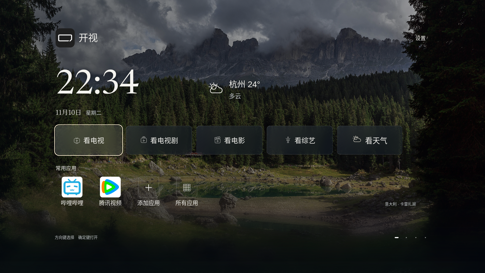
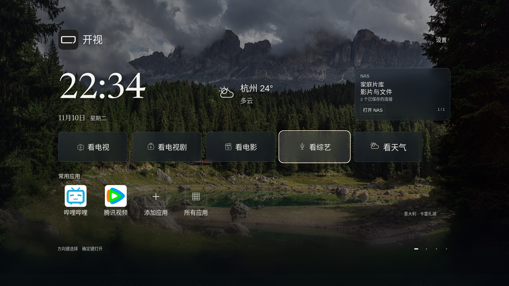

# 首页天气摘要 · S115

S115为标准版开发修改，随后由S116汇入[v45安装包](RELEASE-V45.md)。v44安装包没有本轮改动。爸妈版布局不调整；发布状态以v45发行页为准。

时钟右侧新增独立、常显的天气摘要：城市、温度、天气图标与天气状况。主文字38、状况28设计像素，沿用实际窗口等比缩放；1080p约33/24像素，4K同步放大。摘要不进入遥控焦点，不占用观看按钮的位置；向下翻屏时随首页隐藏。NAS等家庭面板已配置时仍保留独立空间。

“看综艺”右侧按钮固定写“看天气”，使用现有天气矢量图标。向右、确定打开24小时/未来7天天气，返回恢复到按钮；向左回到看综艺。天气摘要继续复用原有模型、IP定位、选城市、缓存和刷新机制。关闭、读取、失败或过期分别显示真实状态，不填默认温度。

本机兼容首页同步增加大字温度和天气状况，并将按钮改为“看天气”。共用天气页和玻璃首页的最近成功读数；无新鲜读数时使用现有固定提供方获取IP城市对应的预报，主线程不执行网络。退后台或视图销毁取消任务，旧响应以世代号丢弃；超期/异常读数不展示为当前预报。兼容首页没有单独新增城市管理界面。

## 验证

- 浏览器：960×540/dpr4、1280×720、1920×1080、3840×2160/dpr2；摘要与时钟/家庭NAS面板无重叠，字体设计尺寸保持38/28，综艺向右进入天气并返回、向下翻屏隐藏摘要。离线不展示虚构温度，联网恢复；关闭天气时保留关闭状态。
- 生产快照模型：13项合成读数检查，覆盖过期/未来时间、无效温度、旧观测和缓存时效。
- 天气返回路径：25项JVM框架替身检查；固定天气提供方传输15项检查。
- 全首页12组分辨率/密度回归通过，涵盖四屏翻页、常用应用图标、设置抽屉与相册；[收据](verification/s115-home-regression.json)。
- 原生源码定向编译126份、29项尺寸案例。没有构建APK，没有连接小米电视，没有执行本机兼容首页的实际网络、绘制或跨端流程。

首轮浏览器初始化遇到新增变量与矢量图标函数重名，导致launcher启动中断；已改名并由完整首页初始化与遥控任务复测。天气传输旧测试引用被清理的artifacts/nas-classpath.txt；改为发现已有离线Gradle依赖，不恢复无用产物，不额外下载依赖。

验证收据：[浏览器](verification/s115-home-weather-browser.json)、[快照](verification/s115-weather-snapshot.json)、[天气返回](verification/s115-weather-return-native.json)、[原生编译](verification/s115-native-compile.json)。截图为浏览器合成天气与应用状态，不是真实杭州预报或小米真机。

