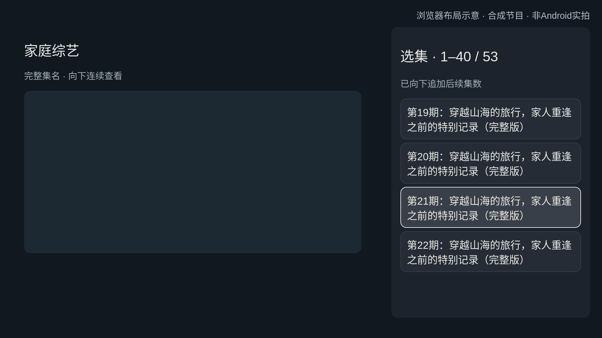
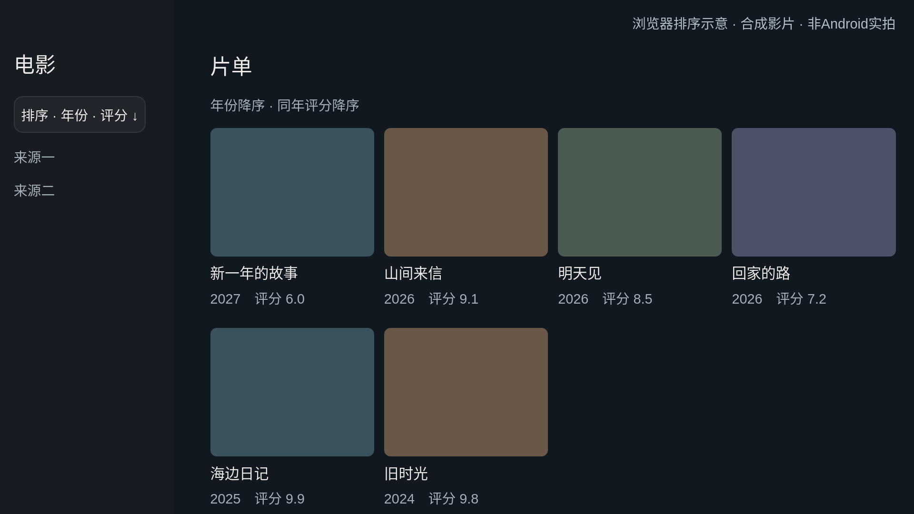

# 直播、选集、排序与切线 · S123 / S125—S135

对应P137—P149，纳入[V48](RELEASE-V48.md)。本轮只适配小米电视Android 8+，不更改电视分辨率或系统density。发布状态以发行页与公开回读为准；没有连接小米真机。

## 直播左侧栏

旧V47侧栏只持有当前来源的频道。资源包把分组分成多个`lives`来源时，即使有多个来源，侧栏也可能只看到一个分组，左右按键停在原组。

新版先在同一来源内切组，到边界再跨直播来源，双向循环。远程来源按需读取，不预取所有来源；浏览仍保持原节目播放，按确定才更新来源并播放所选频道。一次物理按键只换一组，忽略长按重复；过期读取与旧焦点回调不能覆盖新分组。读取失败/空组有提示，仍可左右离开；返回关闭侧栏。只有一个实际来源和分组时不会虚构新组。

频道侧栏打开时，菜单键回到画面控制条并聚焦“换线路”。原生小爱按键继续先交还系统。

## 画面一级换线路

直播控制条为播放/暂停、频道、换线路、更多；多线路点播也直接提供换线路。更多里移除重复的切线入口。直播面板标明当前线路，只有一条线路时直接提示，不重启当前节目。

## 向下连续选集

详情页不再出现上一组/下一组按钮；到当前末行按向下会追加20集，并进入下一行同列。播放中的选集抽屉同样保留已有集数再追加。长标题完整换行，不截成单纯的数字。恢复靠后集数时先创建附近批次，上翻可补前面批次，不一次创建全部30001集的按钮。

这里追加的是已从详情获取的集数列表，没有额外网络请求；不伪造网络加载过程。换线时仍根据真实线路和集数索引播放。

## 每次影片追加都按年份优先排序

首次片单与后续所有页统一：年份降序，年份相同时评分降序。豆瓣模式也先比较年份，再比较可确认来自豆瓣的评分；缺失资料排后。明确的出品年份优先，年份缺失可使用来源真实上映日期的年份，不把最近更新时间冒充出品年份。只有年份和评分都相同，才以更新时间打破平局。

每次下一页回来后，对全部已加载内容重排，保留已有海报View和当前选中影片的可视锚点；不会只把新一页排好后接在旧顺序后面。排序范围仍是当前已加载内容，不能声称远端未获取的所有影片都已全库排序。

## 播放中同名综艺集数切线

原播放Plan先抽取集号，“第1期（上）/（下）”都成为同一个key，可能把有完全同名的集数也判为不唯一；返回详情的续播路径原先会优先完整名，因此结果不同。

现在Plan与Resume使用同一匹配：唯一完整原名 → 全半角、空白规范化后的完整名 → 唯一集号 → 既有单电影正片标签兼容。上/下、加更等有意义的文字不丢弃。切线保留当前进度；真正重复或多义的标题仍不猜，失败时保留原线路和集数。

## 复现和证据

```bash
python3 scripts/s123-live-test.py
python3 scripts/s125-episodes-test.py
python3 scripts/s126-sort-test.py
python3 scripts/s127-line-match-test.py
python3 scripts/s129-stream-test.py
python3 scripts/s130-source-return-test.py
python3 scripts/s131-album-test.py
KAISHI_WEATHER_RETURN_RECEIPT=docs/verification/s132-screensaver-return.json python3 scripts/s109-weather-return-test.py
python3 scripts/s129-native-compile.py
CHROMIUM_PATH=/opt/google/chrome/chrome node scripts/s131-album-browser.mjs
CHROMIUM_PATH=/opt/google/chrome/chrome node scripts/s123-live-preview.mjs
CHROMIUM_PATH=/opt/google/chrome/chrome node scripts/s125-episode-sort-preview.mjs
```

- 生产侧栏34项检查，明确使用JVM UI/HTTP替身；基线来自公开V47的真实源码，复现单来源一组右键不变。
- 从生产Activity逐字提取线路菜单，3项当前线路/切换回调/单线路反馈检查通过；一级工具条位置与事件路由为源码断言，并经实际Android API编译，不把它当作系统注入按键验收。
- 19项生产选集追加、旧按钮保留、长标题、尾批、靠后恢复及焦点检查通过。
- 87项跨页年份/评分与可视锚点检查，33项日期/导入、18项应用/出处、18项片单面板回归通过。
- 11项同名、上下期、全半角/空白、歧义与进度保留检查；已有36项磁盘重开、线路重排、旧记录与直播线路记忆回归通过。
- 131份生产Java源码编译及29项尺寸检查通过；两版正式构建与包核验单独记录在V48候选收据。

[侧栏及线路](verification/s123-live-controls.json) · [原生编译](verification/s129-native-compile.json) · [选集追加](verification/s125-episode-append.json) · [排序](verification/s126-year-score-sort.json) · [切线及进度](verification/s127-line-match.json)

所有夹具使用合成频道/影片与example.invalid地址，没有真实资源站、Android解码或小米真机遥控验收。以下画面是浏览器绘制的布局示意，并非Android截图或电视实拍：





首次预览默认浏览器路径失效，改用已有Chrome执行，未下载额外浏览器；一项包核验最初错误匹配了无关节目单的“下一组”，已拦截未上传候选并收窄到选集类。中途收到补充需求的本地候选均被替代，最终统一重建，不发布半份需求。过程见[日志](process/JOURNAL.md)，传播编辑稿见[第96期](../media/DEVLOG-096.md)。


## 播放缓冲与缓存

网络播放使用Media3 1.6.1与OkHttp。点播前向25—60秒、起播2秒、再次缓冲5秒；直播8—20秒、起播1.5秒、再次缓冲3秒。目标内存按堆预算控制；点播磁盘LRU最高128 MiB，剩余空间低于64 MiB绕过。直播不落盘，NAS仍走既有本地协议与系统播放器。缓存key按地址与凭证请求头隔离；每个媒体请求/跳转重新验证HTTP策略，跨域剥除认证、Cookie及私有请求头。现有PlaybackSession继续管理音频焦点，Media3不另行接管。格式/解码失败可回退系统播放器，保留进度和已撤销的播放意图。

[44项策略与真实本机HTTP/Range/跳转检查](verification/s129-stream.json)通过，不包含Android解码或SimpleCache真实播放；不声称已量化提升播放流畅度。

## 来源返回、首页相册和屏保退出

[来源返回](verification/s130-source-return.json)运行实际提取的任务取消方法，10项调度检查通过。返回先取消请求和世代，回到片单、详情或原内容，旧成功/错误/插件回调不能重开输入。

首页相册将首张图直接设为不透明，不依赖新图淡入动画完成；前台每5秒读取照片索引，相同索引不重复解码，有上传/删除才刷新。原生控件失焦时解除图片引用，不回收已交给ImageView的位图，避免OEM渲染线程残留引用；未提交的过期解码仍可回收。网页相册先绑定load/error再设置地址，验证naturalWidth，失败保留已有照片，不把透明的失败帧换到前台。停止依赖will-change建立图片图层。

[10项原生相册逻辑](verification/s131-album-native.json)使用停滞动画和存储/UI替身；[完整首页浏览器检查](verification/s131-album-browser.json)用合成图测试960/1920/3840视口、上传后轮询可见、失败保留和删除最后照片。画面不是海信或小米实拍；海信报告的具体硬件根因尚无日志，不能称为真机已修复。

屏保设置与天气子页的返回统一走原生目的地，不等待JS；退出前封闭网页回调与天气活动，后续失焦/暂停不再evaluate。仍在预览子页的异步返回设600ms兜底。异常任务根恢复应用首页。[29项生命周期检查](verification/s132-screensaver-return.json)使用明确JVM框架替身，包括正常返回、任务根、重复按键、迟到回调与渲染器退出。没有用户设备崩溃日志，实际闪退定因和恢复仍待真机复测。


局域网控制配对码窗口为5分钟，LocalControlSession与HTTPS监听定时共用常量；电视文案与安装说明同步。13项边界测试见[配对验证](verification/s133-pair-window.json)，只运行会话逻辑与源码定时接线检查，非真实局域网配对验收。


设置菜单增加长按向下两级加速，原生依据repeat与按住时间，网页传递同样元数据；短按及确认不加速。验证见[设置加速](verification/s135-settings-scroll.json)。
