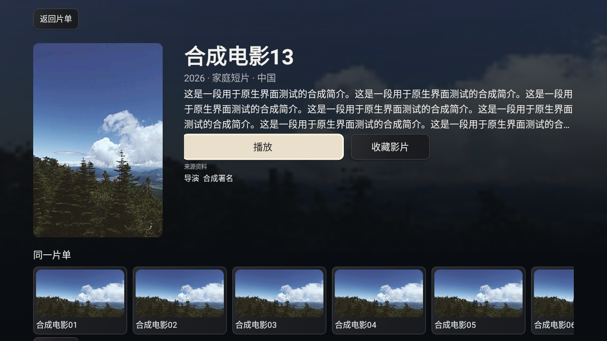
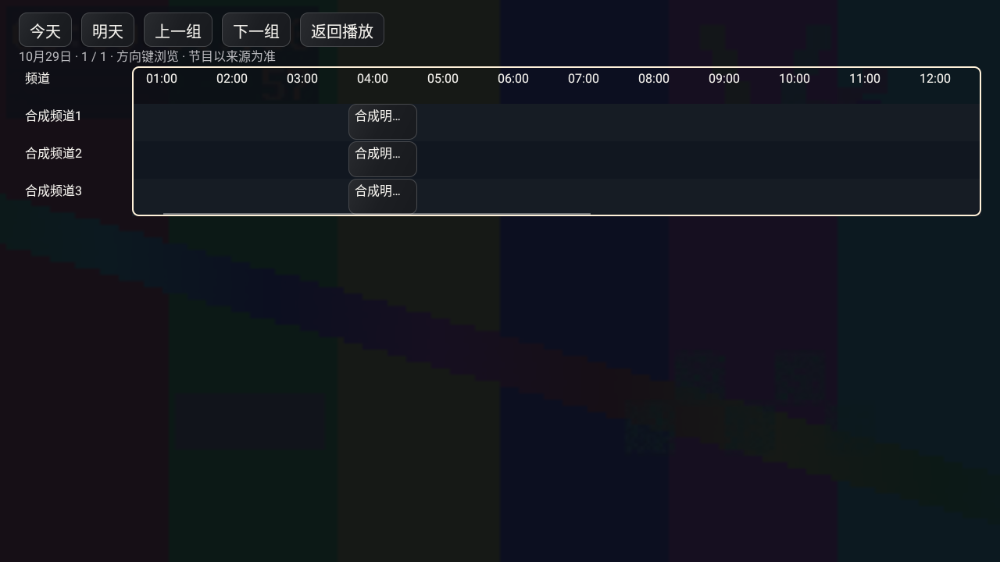

# S62：v20报告的原生回归

此阶段继续“确保所有的测试建议修复完成，并且正式发布”的既有目标，不因v21已经发布而跳过原生检查。本轮原生回归已完成，v22 / alpha.19进入发行准备；v21旧标签和附件保持冻结。

## 本轮新增修正

- 节目单先前只更新侧栏。现在频道列表和播放浮层也接收当前/下一节目，30秒刷新显示，不重建列表或改变焦点。
- 详情主按钮按屏宽限宽并保留聚焦放大后的间距；海报圆角与焦点可见范围一并检查。
- 详情背板曾调用 `ImageView.setAlpha(0)`：整数重载把图片alpha清零，随后View淡入也无法恢复。已改为浮点 `setAlpha(0f)`。R3交互检查通过但截图仍为黑底；R4在同一旧APK上新增图片alpha检查，实际返回0并失败，保留失败回执。不能用R3的绿色结果认定视觉完成。
- 节目表顶部按钮增加间距，时间网格获得焦点时显示描边；目录仅在来源有多批内容时显示批次，避免“标题1/1”与底部“2/3”互相混淆。

## 环境与证据分层

使用只读API28 Android TV x86模拟器、ANGLE/SwiftShader软件渲染。主机没有KVM；本轮启动约443秒后确认 `sys.boot_completed=1`，取得实际原生画面。第一次流式安装超时，单独推送安装成功；开发模拟器启动后关闭其GMS后台以减少软件模拟负担。没有改用户电视、擦除原AVD或操作小米账号。

测试包是调试版、x86。真实MediaPlayer播放本机生成的H.264/AAC测试图案，不是网上频道。实际资源包为合成片单、频道和XMLTV，没有真实账号或私人NAS数据。模拟器不能证明小米ARM设备、原生小爱/米家、真实WorkBuddy或真实在线资料账号兼容。

## 原生用例

`tests/android/RevisionRunner.java`驱动生产Activity和控件；只允许ranchu/goldfish模拟器上的debug目标。每次清理目标测试包的影院偏好后加载合成包，不可在用户真机执行。工具包不进入产品APK。

主要检查：生产配置加密保存/重复导入不追加；单主播放、真实资料、同片单条目、实际背板与按钮间距；MediaPlayer时长、预览/确认跳转、暂停意图、控制栏收起/唤醒；续播、收藏、追剧、集数与切集归零；返回第二页原焦点；异步EPG不换焦点；同一解码器下预览、取消、闲置关闭、确认换台、数字跳台；节目单日期/方向键/焦点与返回；503真实媒体错误、错误不变成暂停和一次返回。

第一轮测试驱动对空contentDescription调用contentEquals，驱动自身失败，非产品崩溃。第二轮将慢截图放在5秒自动关闭与Back之间，混淆两条任务流；拆开验证后，两种行为均通过。实际截图和回执按各自构建保留，不能把旧黑背板图片当作修复后的效果。

两版各40项完整原生检查通过，见[标准版](verification/s62-native-standard.json)、[爸妈版](verification/s62-native-parents.json)。R3曾通过34项但未覆盖图片自身alpha；R4明确暴露背板alpha=0。快按焦点的旧包确定性用例把新选择1抢回0；修复后保留1并保持可见行焦点，数字键也会取消已排队的闲置隐藏。完整检查后的画面复核发现横向滚动使焦点描边偏移，已在描边绘制中补偿scrollX/Y。标准版定向21项通过，爸妈版曾因EPG空白失败；失败回执保留，不计为通过。随后加入有界重试与30秒失败缓存，完成一次503注入后的两版完整回归，见文末最终结果。原资源包缺失和真实账号未验收继续保持未完成，不填写虚假海报命中率。

## 复现

先准备本项目本地Android工具链，设置JAVA_HOME、ANDROID_HOME、APERTURE_ANDROID_RUNTIME和PATH。没有KVM时，仅对自建开发AVD使用：

```bash
export ANDROID_AVD_HOME="$APERTURE_ANDROID_RUNTIME/avd"
export ANDROID_I_WANT_MY_TCG=yes
"$ANDROID_HOME/emulator/emulator" -avd YOUR_TEST_TV_AVD -port 5568 \
  -read-only -accel off -no-snapshot -no-window -no-audio -no-boot-anim \
  -gpu swangle -feature -Vulkan -cores 2 -memory 2048 -show-kernel
```

等同一模拟器确认启动完成，不在观察超时后反复重启。用FFmpeg本地生成自己的120秒测试片：

```bash
mkdir -p artifacts
ffmpeg -f lavfi -i testsrc2=size=320x180:rate=12 \
  -f lavfi -i sine=frequency=400:sample_rate=48000 -t 120 \
  -c:v libx264 -profile:v baseline -level 3.0 -preset ultrafast \
  -pix_fmt yuv420p -g 48 -c:a aac -b:a 32k -ac 1 \
  -movflags +faststart artifacts/native-ui-fixture.mp4
KAISHI_UI_TEST_VIDEO=artifacts/native-ui-fixture.mp4 \
  node scripts/emulator-feedback-v20-fixture.mjs
```

该服务只监听127.0.0.1；读取`artifacts/s62-fixture/server.json`取得模拟器可用base。随后按[本地构建](ANDROID-LOCAL.md)工具配置，以`-PkaishiAbis=x86`构建两版debug，不改变默认ARM发行策略。分别构建驱动：

```bash
python3 scripts/build-revision-emulator-tests.py --edition standard
python3 scripts/build-revision-emulator-tests.py --edition parents
```

使用明确的`adb -s emulator-5568`安装对应debug包与工具包，再用生成manifest中的instrumentation运行。`-e fixture`填写上述base。标准版示例：

```bash
adb -s emulator-5568 shell am instrument -w -r \
  -e fixture http://10.0.2.2:REPLACE_PORT \
  org.zhixiaoce.aperture.test.standard/org.zhixiaoce.aperture.test.RevisionRunner
```

不能仅凭adb退出码判断通过：读取目标包`files/s62-revision-tests/report.json`的`passed`、阶段与逐项checks，并取回同目录原生PNG。模拟器安装、正常播放和故障路径均需看报告；本轮失败记录不删除。


## 最终回归结果

在EPG重试、版本22和节目表viewport修正后的最终源码上，两版完整40项全部通过（均为`channelsOnly=false`、`skipMovies=false`）。[标准版最终回执](verification/s62-native-standard-final.json)、[爸妈版最终回执](verification/s62-native-parents-final.json)、[源码/已安装APK/驱动/截图绑定](verification/s62-native-final-binding.json)。各注入一次节目单503，审计确认下一次有界重试200；不是仅看脚本退出码。[标准故障审计](verification/s62-standard-epg-fault-audit.json)、[爸妈故障审计](verification/s62-parents-epg-fault-audit.json)。连续两次失败后的30秒缓存到期恢复尚无单独故障注入结果，不混同一次失败后的即时重试。

最终Android与随包首页输入SHA-256为`cd6acbc83f1b63d42ba64217dbb2852240b535407b662bbc7edb4d3f1633a32f`，与两版ARM签名发行包输入一致。模拟器实际安装的debug APK由设备`base.apk`直接计算摘要，再与对应debug构建产物核对；未拿ARM发行包冒充已运行的x86包。两版ARM release/lint与签名/ABI/39份首页资源检查另见[发行清单](verification/s63-software-acceptance.json)。

生产Java26项与真实HTTP/gzip8项断言通过，[原始TAP](verification/s62-domain-tests.tap)。标准/爸妈最终详情、时间轴、频道与节目表截图均已查看，背板可见、按钮分离、节目表焦点描边随viewport固定。测试数据和全部海报均为合成/自有演示素材，不代表真实资源覆盖率。



