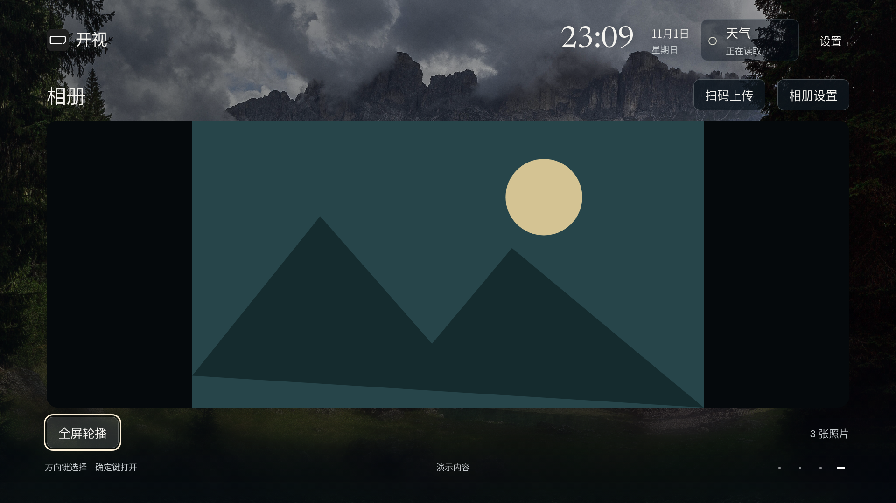
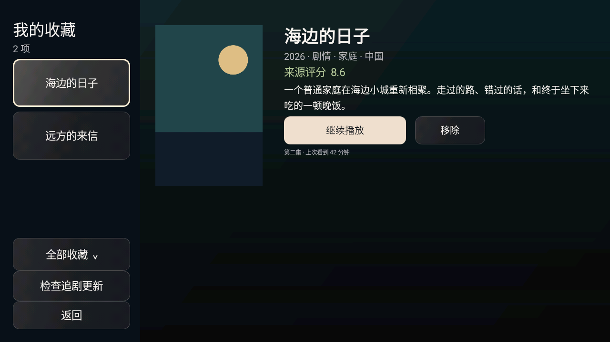

# v36：本机相册、遥控导航与桌面守护

标准版 `0.2.0-alpha.33` / versionCode36，仅小米电视Android8+。沿用v18起包名和签名，可覆盖升级保留配置。爸妈版继续暂停。本版仍为Alpha，未宣称小米85 QLED真机验收。

- 首页第四屏是[本机相册](LOCAL-GALLERY.md)：手机扫码直传电视、三种轮播模板、全屏播放、相册屏保和确认删除。局域网上传窗口需手动开启，10分钟有效，离开设置关闭；不重开旧家庭服务相册。
- 第三屏向上回第二屏、第四屏向上回第三屏；玻璃首页与本机风景首页保留对应方向键路线。
- 我的收藏采用左侧清单、右侧海报与影片概览，可直接继续播放。保存元数据快照，旧记录读取对应来源补齐；清除历史保留收藏，取消收藏保留观看记录。
- 直播频道抽屉使用完整分组列表，左右浏览分组、确定才选频道；浏览页持久左栏也支持左右切组，保留当前组焦点。单组来源不会凭空增加分组。
- [默认桌面与开机](HOME-GUARD.md)增加可选桌面守护、辅助功能授权状态与恢复小米桌面入口。默认关闭，授权后识别小米原桌面窗口；主动返回放行，不读取屏幕内容或过滤按键，不停用小米系统应用。本版不移除固件阶段广告。

## 软件验证

- [本机相册Android28验证](verification/s92-gallery-native.json)：生产存储与上传实现20项，含实际Socket/Android编解码、鉴权、跨源拒绝、EXIF方向与定位剥离、缩略图、删除、容量和关闭。
- [浏览器验证](verification/s92-gallery-browser.json)：1920和960视口四屏往返、预览、全屏、相册设置与二维码；图片为合成数据。二维码从Canvas实际解码。
- [原生界面与直播键](verification/s92-ui-native.json)：Android28模拟器真实方向键从新闻切影视再切回，确定后才选频道；收藏截图使用合成海报与信息。此项不是完整播放器、小米或浏览持久侧栏的真机验收。
- [收藏数据验证](verification/s92-shelf.json)：5项，覆盖快照、旧记录补齐、观看状态以及清历史不丢收藏。
- [桌面守护](verification/s92-home-guard.json)：15项状态转换、4项授权列表保留和4项最小辅助功能声明检查。独立Android28探针确认系统绑定实际生产服务、授权状态与连接状态；不等于小米开机/HOME接管通过。
- 标准版定向release构建、稳定签名、ARM32/64及打包资源一致性检查。发行后的公开附件与冻结来源另以`public-alpha-v36.json`回执为准。

## 真机待验收

小米默认显示设置下首页比例、冷开机与待机唤醒、HOME返回开视和显式退出回小米、小爱/米家共存、多来源直播左右切组与实际播放、手机扫码上传及相册屏保。没有更改用户电视density、分辨率或字体。

本轮过程原文P100—P105与S92见[日志](process/JOURNAL.md)，媒体编辑稿见[第68集](../media/DEVLOG-068.md)。模拟器/浏览器素材需标为软件验证，不能冒充小米实拍。
