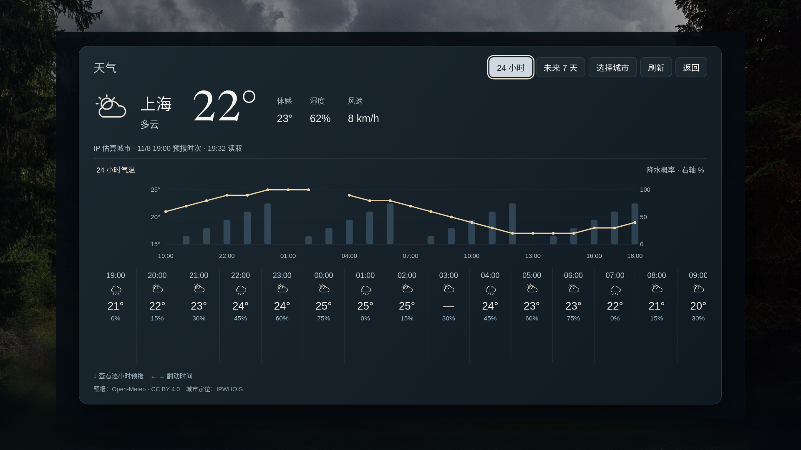
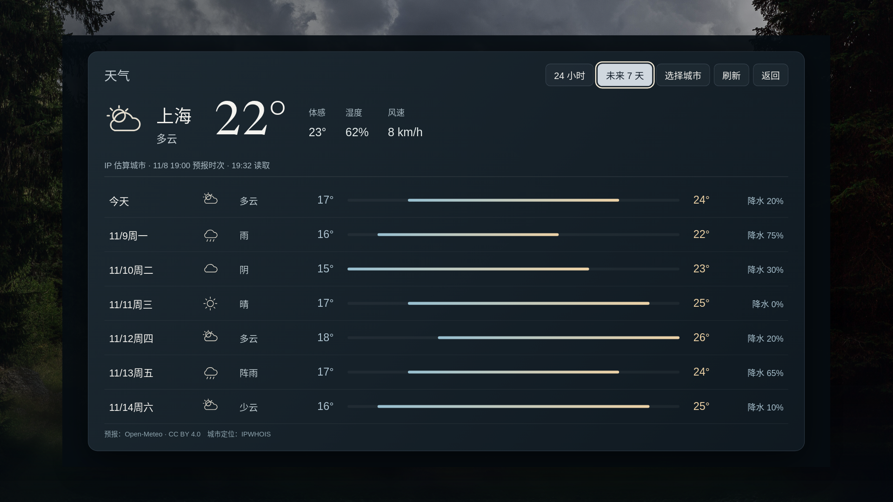

# v41 · 应用居中、扫码留言与天气

标准版 **0.2.0-alpha.38 / versionCode 41**，仅适配小米电视 Android 8+。这是预发布测试版，爸妈版暂停更新。

- 第二屏应用图标在独立画框内居中，名称位于下方；原生首页直接按容器中心绘制图标。
- 首页根据实际窗口宽高统一等比缩放，补充运行中尺寸变化检查，不修改电视全局分辨率或density。
- 原生相册增加本机二维码，旧网页内核也可扫码上传。确认开启后10分钟有效，关闭弹窗或离开相册即停止上传。
- 第四屏和设置增加“扫码编辑留言”。手机与电视连接同一网络后，可添加、编辑、删除电视本机留言；外部HTTPS留言源独立保留。点击“生成二维码”开启10分钟编辑会话，离页关闭。多手机编辑检查版本冲突并保留草稿。
- 天气页增加24小时气温曲线、降水概率、可左右翻动的逐小时预报，以及7天最低/最高温度区间。缺失数据保留断点，保留IP估算城市、选城、断网状态和来源署名。

## 下载与升级

[标准版 ARM32/64 APK](https://github.com/xiaoerdata/aperture-tv-open/releases/download/v0.2.0-alpha.38/kaishi-v41-standard-arm.apk) · [发行页](https://github.com/xiaoerdata/aperture-tv-open/releases/tag/v0.2.0-alpha.38) · [测试清单](https://github.com/xiaoerdata/aperture-tv-open/releases/download/v0.2.0-alpha.38/testing-manifest.json) · [校验和](https://github.com/xiaoerdata/aperture-tv-open/releases/download/v0.2.0-alpha.38/SHA256SUMS)

55,363,900字节，约52.8 MiB，比v40增加24,721字节。SHA-256：`247f682ac417ee6037cd2bca95f7fec5a824abb4981e78b3ffefbf14ae00e9b2`。

沿用标准版包名 `org.zhixiaoce.kaishi`，与实际v40安装包核对为同一发行证书，可覆盖更新，不需要卸载或清除配置。v17继续并存。安装路线见[小米电视安装说明](../INSTALL.md)。

## 验证范围

116份实际Android源码定向编译、29组尺寸函数检查、标准ARM release构建通过。229项Android/launcher输入与安装包资源核对一致，新包含原生二维码和留言编辑类，不含测试注入类。

18项留言增删改、授权、版本冲突、过期和中途关闭检查通过；手机浏览器使用生产协议的真实回环HTTP服务完成增删改，覆盖320/390/760px。原生二维码编码结果经OpenCV独立解码。12组首页浏览器回归通过，另检查运行中540p/1080p/4K及较矮窗口、图标中心、天气曲线断点、遥控滚动、七日温区、城市切换和断网空态。

回执见[扫码与天气](verification/s105-phone-weather.json)、[首页回归](verification/s105-home-regression.json)、[编译](verification/s105-native-compile.json)和[包一致性](verification/s105-release-candidate.json)。候选阶段的`published:false`描述当时状态，正式发布与匿名下载读回另以公开发行回执记录。

**尚无本轮小米真机验收。** 默认显示设置下的原生比例、真实手机跨设备扫码、上传照片及留言持久化仍待复测；浏览器、回环协议和编译通过不能代替小米85 QLED实机结果。旧完整云端矩阵也未据此改为通过。

开发过程与[第81期底稿](../media/DEVLOG-081.md)一并保留。
