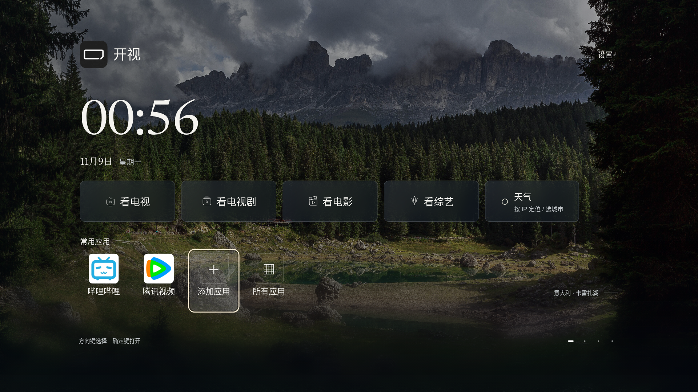

# v43 · 原位加载与观看记忆

标准版 **0.2.0-alpha.40 / versionCode 43**，仅适配小米电视 Android 8+。爸妈版暂停。发布状态以[发行页](https://github.com/xiaoerdata/aperture-tv-open/releases/tag/v0.2.0-alpha.40)为准；本版仍为预发布测试版，尚未完成小米真机验收。

- 首页Logo与“开视”字号放大，网页与原生首页按实际视口统一等比缩放；1080p与4K保持相同比例，不改电视全局分辨率或density。
- 片单进入最后一排预取下一页，底部转圈、原位追加，旧海报、焦点和浏览位置保留；失败原位重试，切换来源不混入旧结果。
- 片单左侧可选最新时间或豆瓣评分降序；仅排列已加载影片，未注明来源的分数不冒充豆瓣评分。
- 每部影片记住最近集数、位置和成功播放线路；完成后仍记线路。修复资料片长覆盖播放时长而影响续播的问题，兼容旧记录。直播记住线路序号，NAS统一进度记录继续保留。
- 天气入口位于“看综艺”右侧；修复独立天气页的返回、任务根恢复和失效WebView访问路径。设备上此前“返回小米桌面”的实际触发条件仍待真机日志确认。
- 第二屏可独立添加最多128个应用，首屏四个位置单独管理。
- 相册提示10秒隐藏；单张上传上限20 MiB，支持分块传输并避免刷新异常丢失上传回复。相册屏保保持照片原亮度，左下显示时间、日期及天气。

## 安装

[标准版 ARM32/64 APK](https://github.com/xiaoerdata/aperture-tv-open/releases/download/v0.2.0-alpha.40/kaishi-v43-standard-arm.apk) · [校验和](https://github.com/xiaoerdata/aperture-tv-open/releases/download/v0.2.0-alpha.40/SHA256SUMS) · [测试清单](https://github.com/xiaoerdata/aperture-tv-open/releases/download/v0.2.0-alpha.40/testing-manifest.json)

55,380,284字节，约52.8 MiB，比公开v41增加16,384字节。SHA-256：`e33ff9510d208c08b9a1cb64d96469d2905b7830e0bda722fba8f68105fff111`。

包名 `org.zhixiaoce.kaishi` 与发行证书沿用。v18—v42标准版可覆盖更新，保留配置与历史，不要先卸载或清数据。v17独立保留，首次从v17使用新包名仍需重新配对和配置NAS。下载的是标准ARM通用包，不需要选CPU架构。

## 本地验证与真机边界

标准版ARM release已实际构建、签名并与v41证书核对；安装包资源和本次产品输入逐项比对，新生产类存在，测试注入类未打入。12组浏览器分辨率/密度检查覆盖360p、540p、1080p、4K和较矮窗口，Logo和控件等比、四屏导航及右侧设置通过。

上传协议、20MiB边界、应用列表、相册提示和照片亮度使用生产协议/模型及合成数据验证。天气返回和片单网格的原生路径使用明确JVM框架替身；进度测试含真实临时文件重开、旧数据迁移和NAS并发记录回归。没有执行真实Android解码、AndroidKeyStore、小米任务栈或真实手机跨设备上传，不能据此宣称这些真机流程已经通过。

优先真机复测：默认显示设置的Logo与比例；天气返回留在开视；连续翻三页无整页跳转；非首条线路退出再续播；20MiB照片扫码上传。异常时保留操作路径与系统日志，不修改电视density来适配应用。

详细记录：[相册与应用](HOME-UPDATES-S108.md) · [天气返回](WEATHER-RETURN-S109.md) · [观看记忆](PLAYBACK-MEMORY-S110.md) · [原位加载](BROWSE-APPEND-S111.md) · [本次发布过程](process/JOURNAL.md)。

