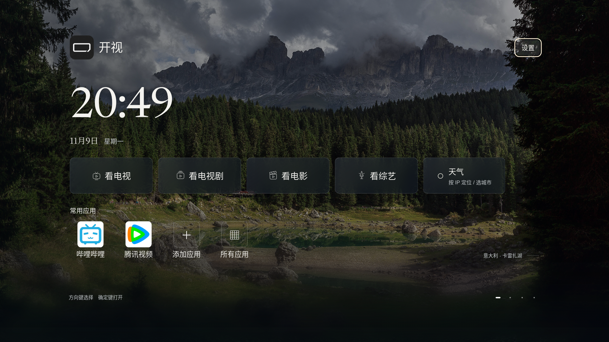

# v44 · 已安装应用与片单排序

标准版 **0.2.0-alpha.41 / versionCode 44**，仅适配小米电视 Android 8+。爸妈版暂停。本版仍为预发布测试版，小米真机验收待完成。发布状态以[发行页](https://github.com/xiaoerdata/aperture-tv-open/releases/tag/v0.2.0-alpha.41)为准。

- 首页“添加应用”打开实际安装的应用库。读取电视与普通启动入口，排除自身、停用和不可启动项；显示系统提供的图标和名称。未知品牌的应用也能添加，不展示未安装的推荐品牌。第二屏应用管理复用同一发现逻辑，最多128项，首屏四个位置独立配置。
- 电影、电视剧、综艺片单默认日期降序。优先上映/首播日期；没有完整日期时按年份；均缺失时使用来源更新时间。同日期按更新时间，全部缺失放最后。海报下显示对应日期或年份，仅有更新时间时注明“更新”。
- “排序 · 日期 ↓”固定在左栏标题下，不随来源列表滚走；按确定可选日期或豆瓣评分降序。切换后按钮显示当前方式。评分缺失或未注明豆瓣来源的普通分数不冒充豆瓣评分。
- 支持常见 JSON 日期别名、秒/毫秒时间戳、ISO、中文/斜线日期、年份、XML日期及资源包 `releaseDate`。无效首字段不再遮挡后续有效字段。资源包规则见[格式说明](RESOURCE-PACK.md)。
- 保留[v43](RELEASE-V43.md)的观看进度与线路记忆、片单原位追加、天气返回、20MiB相册上传、原亮度照片屏保和大屏Logo比例。

仅排列当前已加载内容；向下取新页仍原位合并排序并保留浏览锚点。来源未提供日期的记录无法推断上映顺序；没有对直播频道编造日期排序。

## 安装

[标准版 ARM32/64 APK](https://github.com/xiaoerdata/aperture-tv-open/releases/download/v0.2.0-alpha.41/kaishi-v44-standard-arm.apk) · [校验和](https://github.com/xiaoerdata/aperture-tv-open/releases/download/v0.2.0-alpha.41/SHA256SUMS) · [测试清单](https://github.com/xiaoerdata/aperture-tv-open/releases/download/v0.2.0-alpha.41/testing-manifest.json)

APK 55,380,284字节，约52.8 MiB；SHA-256：`224685d61844d4b9d3291e18c9da77a8816549422fa36483f1a3ba4aafb9352b`。标准ARM32/64 release已本地构建并核对v43签名。238项产品输入与打包资源一致，新日期与排序路径已在DEX内确认。

沿用 `org.zhixiaoce.kaishi` 和原发行证书，v18—v43标准版覆盖安装保留配置。不要先卸载或清数据。v17仍独立保留；首次迁移见[说明](MIGRATION-V18.md)。

## 验证边界

13项生产应用发现逻辑检查使用PackageManager替身；33项日期/排序/JSON与XML导入检查、9项固定排序按钮与焦点检查通过。原位分页、编译与12组浏览器视口回归分别记录。排序按钮检查为JVM视图替身；首页图片为浏览器、合成应用状态。没有连接小米电视，不代表实际遥控、解码、固件桌面与跨手机上传验收。

详见[应用检查](verification/s113-installed-apps.json)、[日期检查](verification/s114-cinema-dates.json)、[排序入口检查](verification/s114-sort-rail.json)、[浏览器回归](verification/s114-home-browser.json)、[开发记录](process/JOURNAL.md)。

