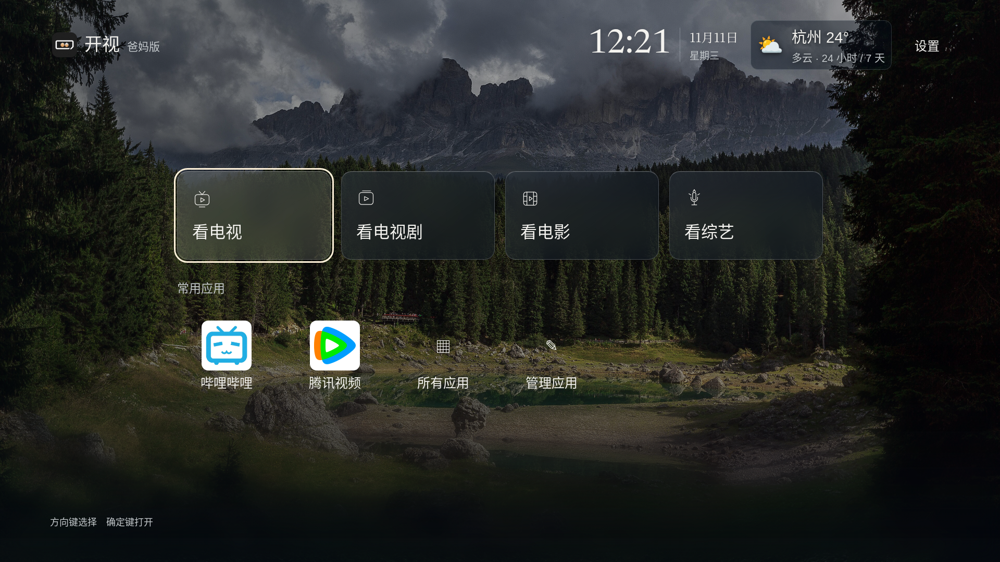

# v45 · 爸妈版同步

爸妈版 **0.2.0-alpha.42-parents / versionCode 45**。仅适配小米电视 Android 8+，仍为预发布测试版；小米真机待复测。与标准版v45使用完全相同的239项产品输入，产品源码提交 `861bac52ef79c1f2f7eba382469596034882ed4a`。

首页保留看电视、看电视剧、看电影、看综艺，以及较小的常用应用与大字天气入口。同步共享底层的片单日期/豆瓣评分排序、固定排序入口、播放位置与线路记忆、原位分页追加、真实应用发现、NAS和天气返回修复。爸妈版继续使用简化布局，不搬入标准版家庭轮播/相册配置页。

## 下载

[爸妈版 ARM32/64 APK](https://github.com/xiaoerdata/aperture-tv-open/releases/download/v0.2.0-alpha.42/kaishi-v45-parents-arm.apk) · [爸妈版校验和](https://github.com/xiaoerdata/aperture-tv-open/releases/download/v0.2.0-alpha.42/SHA256SUMS-parents) · [爸妈版测试清单](https://github.com/xiaoerdata/aperture-tv-open/releases/download/v0.2.0-alpha.42/parents-testing-manifest.json)

55,408,956字节，约52.8 MiB。SHA-256：`8d54b5e301e8d3663d59f8803f826bccd64941c0efdb5773f97e9ee8d0d751b0`。

已下载公开v32爸妈版并核对包名与证书，同签名更新可保留原配置，勿先卸载或清数据。爸妈版包名 `org.zhixiaoce.kaishi.parents`，与标准版独立；标准版用户新装爸妈版需单独配置，不能自动读取另一应用的NAS密码。v17旧爸妈版仍使用不同包名，按[迁移说明](MIGRATION-V18.md)并存处理。

爸妈版附件加入[同一个v45发行页](https://github.com/xiaoerdata/aperture-tv-open/releases/tag/v0.2.0-alpha.42)。标准版APK与原有校验附件保留。请按下载的版本使用对应校验文件，不能用标准版SHA256SUMS校验爸妈版。

## 验证

实际parents release构建、生成父母版常量、ARM32/64 ABI、包名/版本/应用名称、Android8+下限、签名、全量打包页面资源以及测试类排除均核对。960×540高density、720p、1080p、4K浏览器检查四入口和方向键、综艺确定动作、天气返回、已装应用图标、爸妈版Logo；天气与应用均为合成测试状态。共享底层来自标准版同一冻结源，既有软件收据不能代替爸妈版真机、实际遥控、硬件NAS或真实解码。

[浏览器收据](verification/s117-parents-browser.json) · [构建候选核对](verification/s117-parents-candidate.json) · [开发过程](process/JOURNAL.md)

