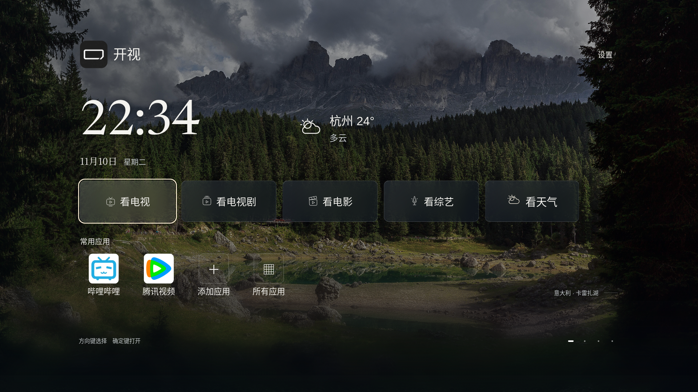

# v45 · 时钟旁看天气

标准版 **0.2.0-alpha.42 / versionCode 45**，仅适配小米电视 Android 8+。爸妈版暂停。仍为预发布测试版，小米真机验收待完成。发布状态以[发行页](https://github.com/xiaoerdata/aperture-tv-open/releases/tag/v0.2.0-alpha.42)为准。

- 时钟旁独立显示城市、温度、天气状况和矢量图标。主文字38、状况28设计像素，随实际窗口等比缩放，不更改电视全局分辨率/density。家庭NAS面板配置后仍保留独立空间。
- “看综艺”右侧固定为“看天气”，不再把摘要挤在按钮内。向右、确定进入24小时和未来7天预报，返回恢复到按钮；天气摘要不占遥控焦点。
- 本机兼容首页同步增加大字温度/天气状况与“看天气”按钮，复用现有预报快照；需要时后台读取固定天气服务。离线、关闭、过期与无效数据分别处理，不填默认温度，后台和销毁取消任务。
- 保留[v44](RELEASE-V44.md)的真实应用库、固定片单排序、日期/豆瓣评分排序，以及之前的观看记忆、原位加载、NAS和相册功能。

## 下载与升级

[标准版 ARM32/64 APK](https://github.com/xiaoerdata/aperture-tv-open/releases/download/v0.2.0-alpha.42/kaishi-v45-standard-arm.apk) · [校验和](https://github.com/xiaoerdata/aperture-tv-open/releases/download/v0.2.0-alpha.42/SHA256SUMS) · [测试清单](https://github.com/xiaoerdata/aperture-tv-open/releases/download/v0.2.0-alpha.42/testing-manifest.json)

APK 55,380,284字节，约52.8 MiB。SHA-256：`fb1ea1f6255988b6fe709741c4bdfa296d4827620e087fb02150c1dbd9a64d6a`。239项产品输入已冻结，安装包内天气资源与新增生产类已核对。

沿用包名 `org.zhixiaoce.kaishi` 与原发行证书，v18—v44标准版可覆盖更新，保留配置，不用先卸载或清数据。v17仍独立保留。

## 验证与记录

S115的4组天气布局/方向键、12组全首页分辨率/密度、13项天气快照、25项天气返回生命周期、15项固定提供方传输检查，以及126份原生源码/29项尺寸检查，均与本次产品源哈希核对。部分原生路径使用明确JVM替身；天气与NAS画面为浏览器合成状态。本次封装实际执行标准版ARM release构建、签名、打包资源和源码输入一致性检查。小米电视、真实解码和跨手机扫码不因此视为已验收。

实现、失败修正与可复现脚本见[天气改动](HOME-WEATHER-S115.md)、[开发日志](process/JOURNAL.md)和[第90期底稿](../media/DEVLOG-090.md)。先完成公开附件及匿名下载核验，再删除可再生构建目录、旧APK与重复传输副本；保留源码、签名、工具链、当前包和必要的验证记录。

