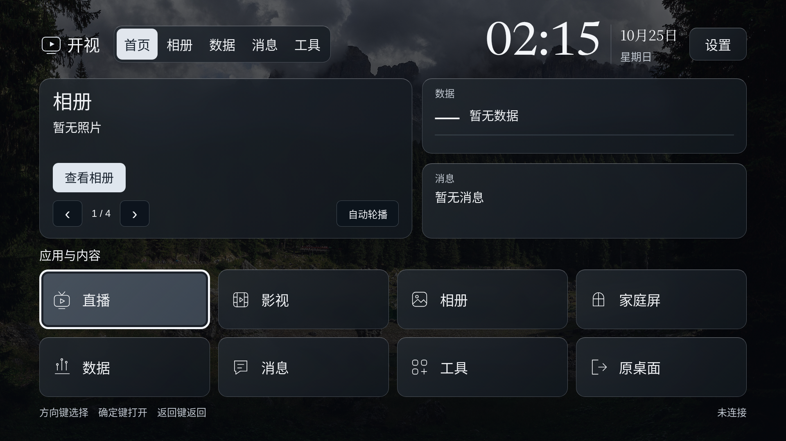
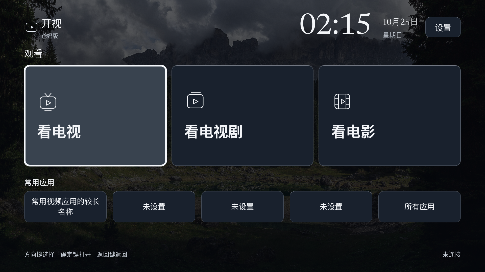

# 开视：电视画面适配与 v14 测试包

S48后续首页结构见[首页留白与翻屏](HOME-PAGES.md)：标准版三屏与更小的爸妈版卡片。本文保留S45/v14布局修复与当时APK记录。

2026-10-25，针对维护者提供的小米电视安装照片修正布局。正式中文名为 **开视**，爸妈版为 **开视·爸妈版**。英文名称仍沿用现有工程标识，不把 Open-MiTV 候选当作已定名。

## 问题与修正

照片显示相册主按钮与轮播控件重叠、底部提示被挤出画面，原桌面重复出现“桌面”。浏览器在 960×540 的逻辑窗口复现了同样的问题：标准版内容高度 572px、底部提示下沿约 564px；爸妈版内容高度 591px、底部提示下沿约 583px。这个复现不代表已经读到该电视的真实逻辑分辨率、型号或 WebView 版本。

原因是按钮与字体设置固定最小尺寸，容器却按屏幕百分比缩短；轮播控件又绝对定位在卡片底部。仅验证 720p/1080p 浏览器窗口漏掉了更低的电视逻辑分辨率。

现在采用统一的 1920×1080 电视画布，根据实际 WebView 可用宽高等比适配。左右各留 96、上下各留 54 个设计像素的安全区；较矮的窗口居中留边。两版布局使用同一尺度，按钮、文字、间距不会各自按不同规则挤压。手机纵向预览继续使用流式布局。

- 相册主操作和轮播控件改为独立布局行，长留言限制为两行，完整内容在分区里阅读。
- 标准版八个入口保持两排；爸妈版维持三个大入口与较小的常用应用行。
- 遥控焦点切换不再滚动整个画布，设置列表保留内部滚动与返回焦点。
- 玻璃表面改为偏黑灰的中性色，保留背景层次和白色焦点，去掉“桌面”重复副标题。
- 应用名称、首页、原生提示、工作台、使用指引与当前发布模板改为开视；发布历史、原始提示词与包名保留。

参考取舍：沿用 [电视设计记录](DARK-GLASS-DESIGN.md) 的材质层级与减少透明回退，以及 [遥控规范](TV-REMOTE.md) 的行列焦点路径。本次以安装反馈和低逻辑分辨率复现确定结构，不新增概念效果图。

## 两版预览

均为实际 Chromium 渲染，空家庭或合成标签，不是小米真机复测。维护者原照片含个人拍摄信息，不复制到公开素材。

## 安装与版本

本轮本地生成 **v14 / 0.2.0-alpha.11 debug** 两版，包名与对应 v13 相同、versionCode 从 13 增至 14、签名证书相同。可以按同签名覆盖升级路线测试，**不要先卸载**；仍需实际电视验证数据保留和系统行为。

本地文件：`artifacts/kaishi-v14/standard/kaishi-v14-standard-debug.apk`、`artifacts/kaishi-v14/parents/kaishi-v14-parents-debug.apk`，各目录提供 manifest、SHA256SUMS 与签名信息。该目录不进入 Git，公开下载仍以 [版本页](DOWNLOADS.md) 为准，本轮没有更新远程 Release。

| 版本 | 文件字节数 | SHA-256 |
| --- | --- | --- |
| 标准版 | 7,621,638 | `407f981c9cfeb885c4825f6872a619e4bae1c5365e53fcc6abe36b38934e0719` |
| 爸妈版 | 7,621,826 | `029558de466b5ed9af8ea79e6d03dc2d0fbd0b44153e842c01ac6445f772b0eb` |

两版包内首页 10 份文件与源码逐字节一致，三方声明也已核对。Android 输入摘要 `b9077c75fc9dfe35e294752c4ef3b18b3777c7b6083e09d8e6b14b513925a4d5`。本地含未提交修改，manifest 明确 `workingTreeDirty=true`，不称为某个干净提交的精确构建；见 [候选检查](verification/s45-v14-candidates.json)。没有新增权限或后台服务。

改名不改变包名、偏好键、NAS 存储和机器协议。电视发起 NAS/应用操作时保留 v13 的旧协议标签，兼容尚未更新的家庭服务；新版服务接受新旧标签，对外显示开视。标签不能替代身份、scope、设备归属与凭证校验。

## 验证与现场检查

`node scripts/browser-tv-viewport-qa.mjs` 覆盖两版各 8 组窗口：960×540、1024×576、1066×600、1280×720、1920×1080、3840×2160、960×500、1280×640。检查安全区、重叠、截断、长菜单、遥控返回、四个分区与离线页面，见 [电视窗口检查](verification/s45-tv-viewport.json)。

既有首页浏览器检查另覆盖内容授权/撤销、NAS 入口、爸妈快捷应用、手机预览与安全文本；两组领域测试共 13 项通过，含新旧名称的应用操作与加密 NAS 交接。一次免费本地双版构建通过，Gradle 24 秒、66 项任务；没有正式稳定签发、小米复测或远程发布。

现场先检查底部提示完整、相册按钮不重叠、八个入口可达；再检查两版、长应用名称、菜单返回、原桌面、小爱、NAS 与旧设置保留。若仍裁边，记录显示模式、型号和系统/WebView 版本，不用卸载清数据处理布局问题。
