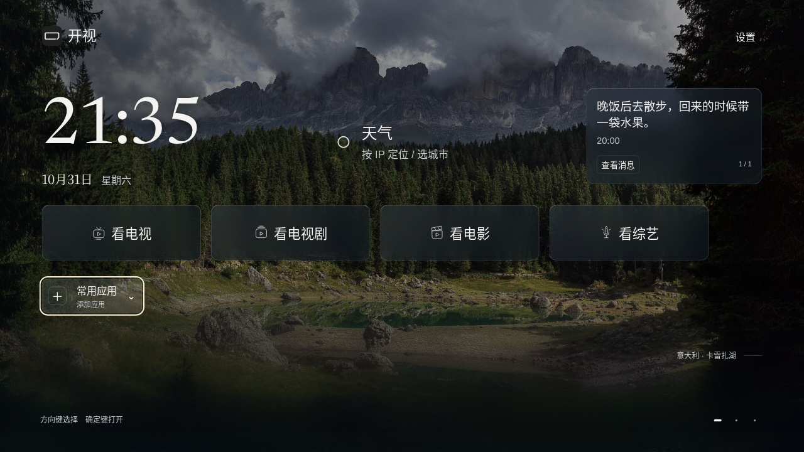
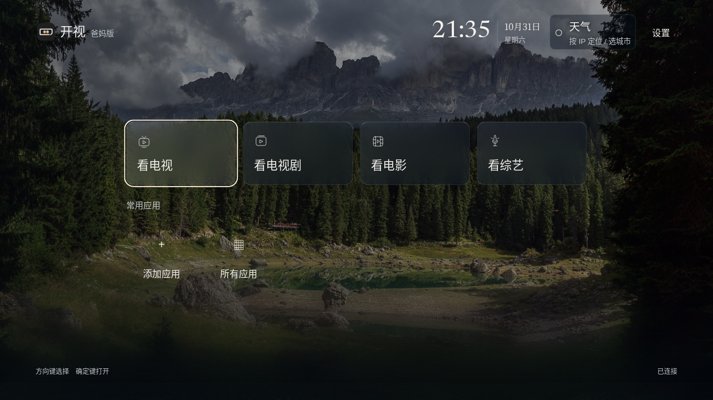
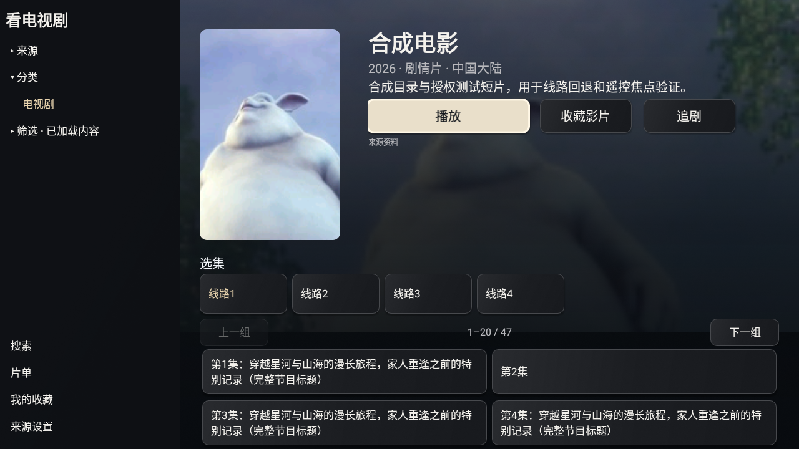
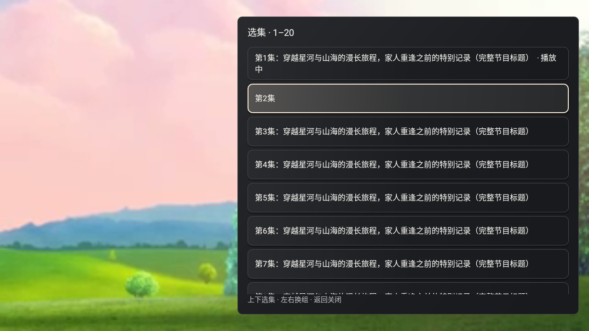

# v29候选：v28反馈处理

本轮对应P76。源码版本为0.2.0-alpha.26 / versionCode29；公开发行仍为v28，没有推送或替换已发布APK。仅适配小米电视，Android8以上；软件模拟器证据不能替代小米原桌面、小爱、米家和OEM屏保验收。

## 改动

| 反馈 | 处理 |
| --- | --- |
| 默认播放网页线路，详情选线不改变播放 | 详情与播放共用选线/选集状态；解析后识别分享页、HTML/JSON响应，媒体读取单次15秒。逐条尝试，不并发探测 |
| 解码失败没有补救入口 | 同集在其他线路顺序回退，每条只试一次；工具栏直接提供“线路”，保留“更多”中的换线。没有匹配集数时不猜播另一集；只有单集影片可按唯一正片匹配 |
| 换线丢失进度 | 同一集手动/失败切线保留可获得的播放进度，重新解析签名地址；历史、收藏、追剧继续使用原来源和影片ID |
| 首页返回始终留在开视 | 根首页交给已选择/已解析的原系统桌面；显式打开成功后finishAndRemoveTask。标准版第一次返回可先收起应用组，随后退出；不改默认HOME |
| 五列跳六列，侧栏不易唤回 | 保持左侧栏可见，取消折叠导致的视口重排；片单固定五列，第一列左键明确回侧栏 |
| 选集区上键乱跳 | 首行、线路与分组控件上键回主播放按钮；播放下键回选集；两列使用同一行高度，保留完整长集名 |
| 弹窗、更多首项裁切 | 共享弹窗用同一物理窗口内的标题、滚动内容和返回区；播放器列表留上下安全空间，首项初始对齐，不缩放行按钮 |
| 留言署名、电视编辑 | 只保留内容和时间；新HTTPS只读留言源、缓存、60秒刷新与前台定时播报，见[留言源v1](MESSAGE-SOURCE.md) |
| 首页右下重复“片库与应用” | 移除按钮及其焦点路径，应用区/摘要按下直接翻屏；所有应用仍在常用应用中 |
| 小米广告屏保先出现 | 已有DreamService保留；自动屏保开启且首页拥有焦点时保持亮屏，离开/关闭即释放。原生固定动作接收开关，不开放JS权限桥；不抢占其他Activity |

## 取舍

报告里的直播黑边与源分辨率、像素宽高比有关，本轮没有强拉伸画面或宣称全面解决SAR。没有附带报告中的第三方资源清单，也没有抓取未授权影视。保留媒体纵横比，使用已有授权短片与合成目录验证交互。

不采纳“监测小米屏保后抢回前台”。小米部分固件使用私有息屏机制，窗口亮屏标志能否阻止该机制仍须真机实测；设置里明确说明必要时调整原系统广告屏保。不改小爱键、麦克风权限、小米账号或米家服务。

共享TvDialogs的消费者包括CinemaActivity、CinemaDetailView、NasActivity、DestinationApps和MainActivity。统一修改的是窗口边界与列表聚焦规则；不是所有NAS配置、安装和系统设置弹窗都改成此组件，也不能把一个截图说成所有对话框验收。玻璃首页、原生恢复首页、服务端家庭屏是不同实现；浏览器留言预览不包含Android语音播报。

## 推广前复测

| 任务 | 必要证据 |
| --- | --- |
| 点播默认/手动切线 | 至少10部合法资源，网页/404/解码失败回退；明确记录失败数，不用HTTP200替代画面与声音 |
| 继续观看、收藏、追剧 | 换线后同集同位置；退出重进；来源刷新后稳定ID仍有效 |
| 遥控器 | 两版OK开列表，默认左右进度，直播上下换台，触摸/小爱后恢复焦点；长按不误触 |
| 布局 | 小米1080p/4K、不同系统字号；五列、长标题两列、来源第五项/末项及更多首项完整可见 |
| 系统共存 | 首页1–2次返回原桌面；直播/点播HOME、语音键、小爱唤醒和米家不退化 |
| 屏保 | 2分钟静置140秒以上，自有星河出现；离开开视释放亮屏；关闭自动屏保后原系统策略恢复 |
| 留言 | WorkBuddy更新文件，下一次成功读取同步；删除/过期/离线缓存/暂停/重启去重/无TTS引擎；不在其他应用播报 |
| 稳定性 | 实机连续观看与切台2小时，断网重连和返回，不出现崩溃/重复弹窗 |

每项以本轮实际证据更新。尚未完成的小米验收保留待测，不提前使用“可公开推广”“已兼容所有小米屏保”等表述。

补充的细节：选中线路以暖色字标记，白框只代表遥控焦点；主播放按钮下键可达线路控件，线路再下进入选集。播放器选集列表独立标明“播放中”，移动焦点不会丢失当前集提示。没有中文语言包时不尝试用其他语言引擎播报。

## 本轮画面

首页为Chromium浏览器合成数据预览；原生详情/选集来自Android28软件模拟器、合成目录与留存授权短片，不是小米真机截图。截图与APK摘要以S76验证回执绑定。

## 最终软件验收

两版均27条Android系统输入通过。包含短于5秒的换线续播修复；标准版4225ms→6880ms、爸妈版35ms→1472ms，后值含操作等待时间。两版release/Lint、稳定签名与源码/资产核对通过。4组首页和13组天气屏保浏览器任务通过。完整摘要见[绑定回执](verification/s76-summary.json)，原生记录见[两版系统输入](verification/s76-native.json)。

这些是本地v29候选的证据；未公开发行。玻璃首页Android窗口亮屏、小米私有屏保、原生小爱/米家、中文TTS实机、WorkBuddy文件发布、外部10部资源首播率及连续2小时使用仍待实测。
