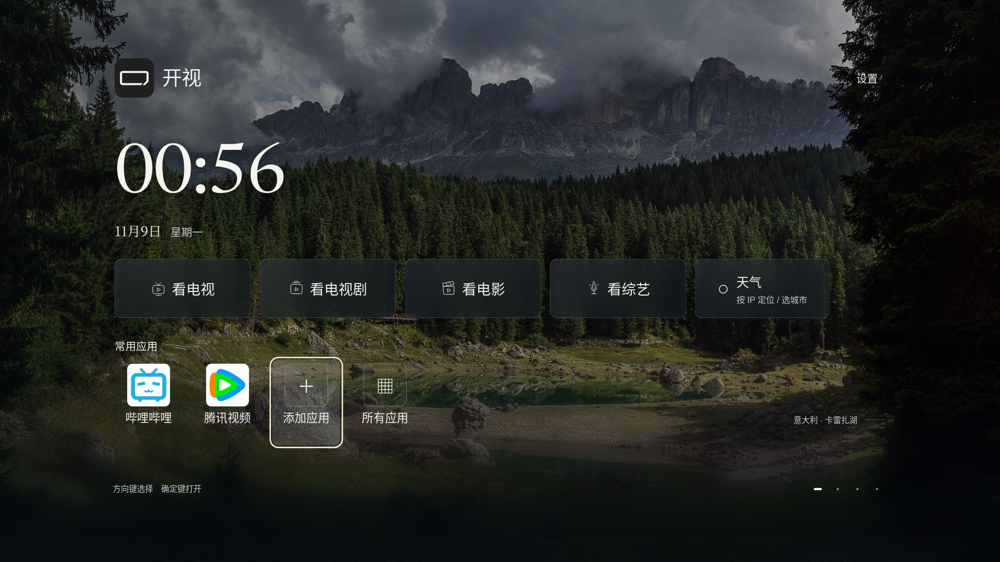
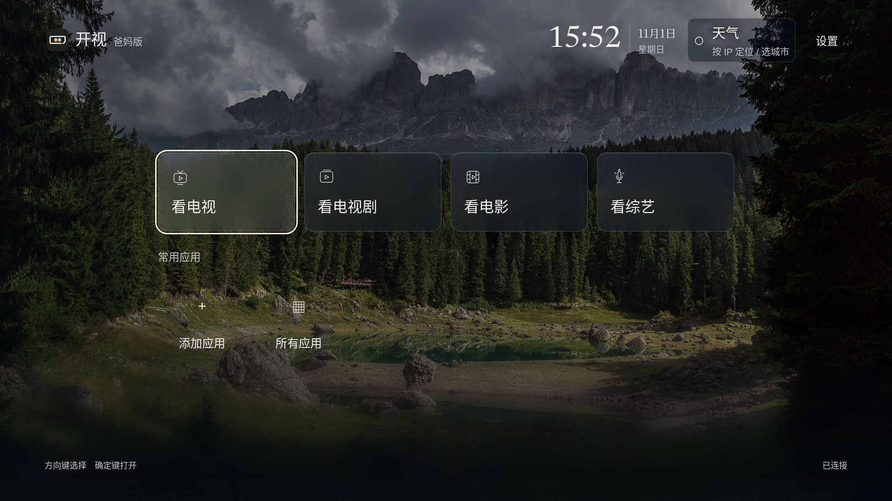
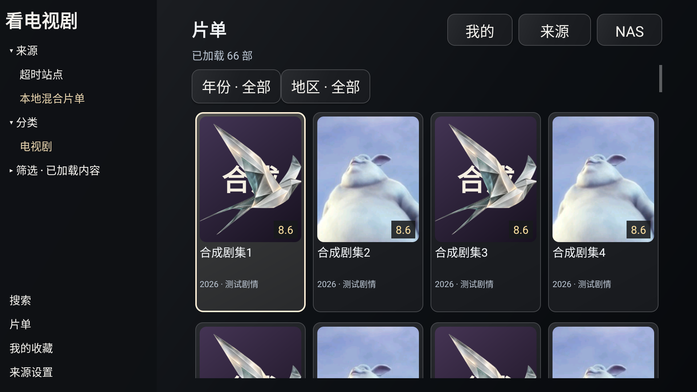
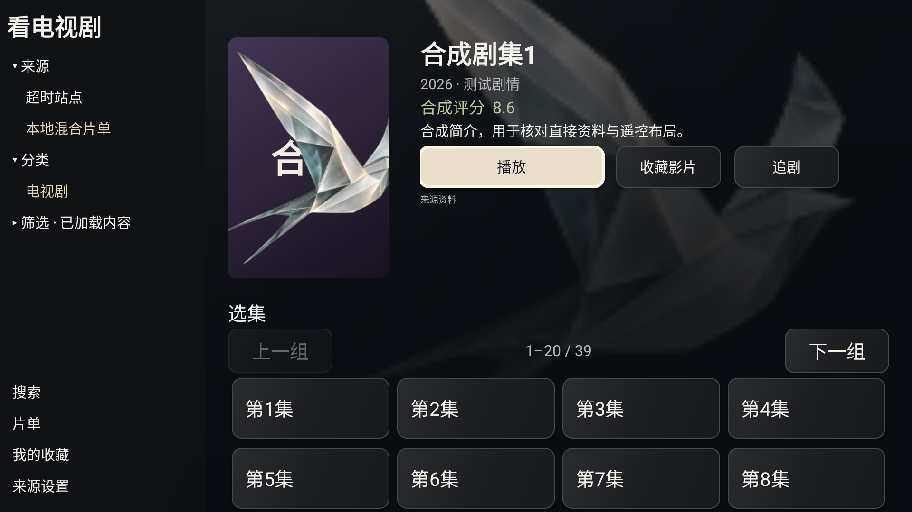
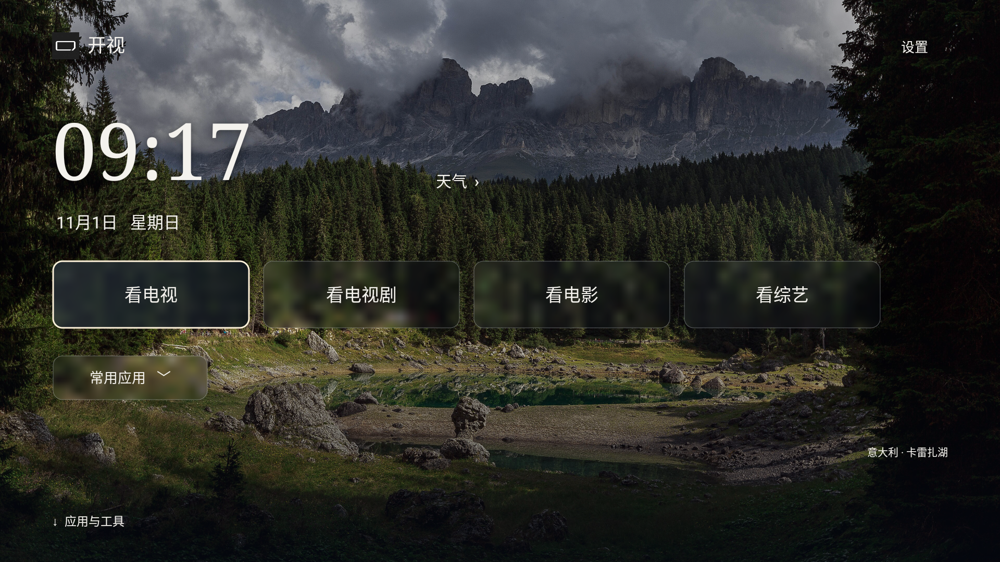

# 开视 · Aperture TV

**本项目仅适配小米电视。** Android 8+ 是最低系统要求，具体机型和固件需要实测。开视是运行在原电视系统上的家庭入口应用，不是小米官方ROM或官方认证产品。

智小策的首个开源项目，当前为 **Alpha 测试版**：保留原桌面、小爱同学与原系统账号，在电视上增加日程、留言、数据、NAS资源和可定制入口。

当前标准版 **v44 / 0.2.0-alpha.41**：添加应用读取电视实际已安装列表；片单默认日期降序，左栏顶部固定排序按钮，可切换豆瓣评分。保留原位加载、观看记忆、天气与相册更新。**这是预发布测试版，小米真机验收未完成**，详见[本版说明](../RELEASE-V44.md)。

**v44可更新v18—v43标准版，保留配置；与v17并存。** 从v17首次使用新包名需重新配对和配置NAS；请先读[迁移说明](../MIGRATION-V18.md)。默认作为普通应用安装，用户可在设置首项申请默认桌面或明确授权守护。

## 版本

- 标准版：首屏看电视、看电视剧、看电影、看综艺、常用应用；向下依次进入应用、相册和留言。深色玻璃、4K摄影背景和遥控焦点。
- 爸妈版（暂停开发，保留历史版本）：看电视、看电视剧、看电影、看综艺，以及常用应用快捷入口。安装和来源配置留在家人设置。





## 安装与使用

按[小米电视安装说明](../../INSTALL.md)开始。[下载与版本](../DOWNLOADS.md)说明两版选择和校验方法；[Alpha测试下载](https://github.com/xiaoerdata/aperture-tv-open/releases/tag/v0.2.0-alpha.41)提供标准版和源码，爸妈版保留历史版本；也可[免费本地构建](../ANDROID-LOCAL.md)。不需要Root、刷固件或停用原桌面，默认作为普通应用启动。

直播与影视支持M3U/TXT、XML/JSON、多仓与type4播放解析；type3支持经用户确认的JAR/Dex、JavaScript/drpy和Python插件。插件兼容有边界，见[内嵌影院](../EMBEDDED-CINEMA.md)与[插件说明](../PLUGIN-ENGINE.md)；没有预置影视来源。

“我的”集中展示NAS和影视观看记录、收藏与追剧。首页摘要按已有配置显示，无数据时保持空白。[智小策Hub](../HUB-DISPLAY.md)预留电影、体重、旅行、账本的授权面板接口；本版尚不能扫码登录Hub。

[WorkBuddy局域网连接](../LOCAL-TV-CONTROL.md)默认关闭，六位码后还需电视确认，限时30分钟，仅操作开视前台，不读取其他应用或受保护画面。

设置里可以从文件选择器或已连接NAS选取独立APK，由原系统确认安装。SMB2/3与HTTPS WebDAV可读取家庭NAS。家庭信息、WorkBuddy和统一片库另使用自托管家庭服务。

官方Agent示例使用[WorkBuddy](../WORKBUDDY.md)：扫码配对后按授权更新内容；安装和卸载应用分别授权，电视开启短期窗口并保留系统确认。请求提交、等待确认与设备回执分开，不提供任意Shell、远程代码或静默安装。

## 开发

需要Node.js 22+、Python 3.10+和Pillow。按仓库现有说明设置本地环境变量，不提交私人凭证。

```bash
npm ci
python3 -m venv .venv
.venv/bin/pip install -r requirements.txt
PATH="$PWD/.venv/bin:$PATH" npm run start:checked
```

配置与家庭服务启动步骤见[部署](../DEPLOYMENT.md)，Android构建见[本地构建](../ANDROID-LOCAL.md)。系统边界见[小米兼容检查](../XIAOMI-COMPATIBILITY.md)，扩展见[开发说明](../DEVELOPMENT.md)。

工作流程与原始需求保留在[开发记录](../process/README.md)。历史文档中的私有下载链接统一指向[下载说明](../DOWNLOADS.md)，不表示历史内测包已公开。公开源码不含私人家庭数据、开发凭证、签名密钥、SDK运行目录或旧私有Git历史。

## 当前验证边界

本版产品已完成 ARM32/64 构建、稳定证书签名及输入一致性检查；本地确认、期限、焦点、诊断和上传代次模型通过。隔离探针已编译，最新默认焦点修正尚无完整云端执行回执，旧候选的通过记录不能代替本版验收。旧内核相册网页超时根因仍未确定；原生替代没有证明网页问题已解决。详见[发布与验证范围](../RELEASE-V39.md)。

小米原桌面、小爱/米家、玻璃首页Android亮屏与OEM屏保、中文TTS、WorkBuddy客户端、NAS硬件、同网mDNS发现、外部点播成功率和两小时播放仍待维护者验收。未做SAR修正，不宣称所有直播黑边已解决。没有预置影视来源，产品继续为Alpha。

天气服务开发机连通不等于大陆电视网络验收；免费Open-Meteo API限非商业用途，见[第三方说明](../../THIRD_PARTY_NOTICES.md)。

问题反馈见[Issues](https://github.com/xiaoerdata/aperture-tv-open/issues/new/choose)，二次开发欢迎[Pull Requests](https://github.com/xiaoerdata/aperture-tv-open/pulls)。

核心代码使用[MIT许可](../../LICENSE)。字体、图片、依赖与上游连接器分别遵守各自许可，详见[第三方声明](../../THIRD_PARTY_NOTICES.md)。






