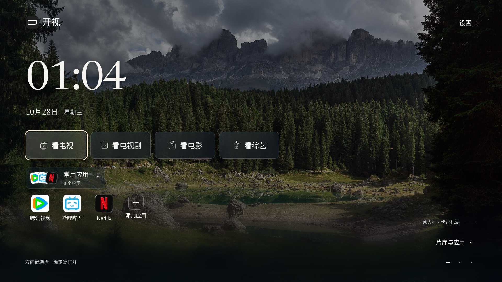
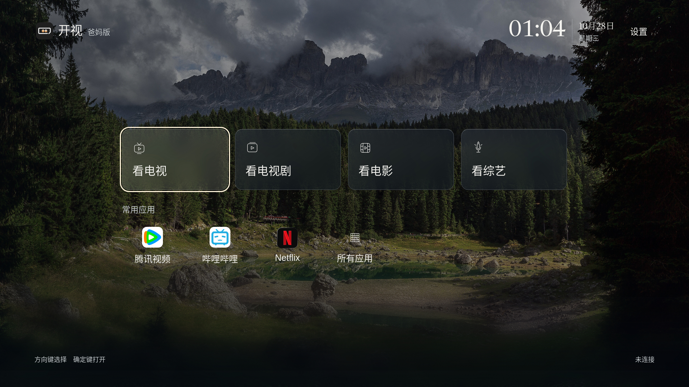
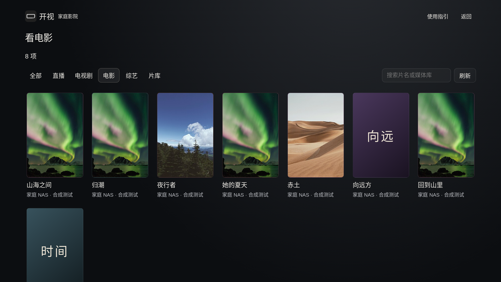

# 开视 · Aperture TV

**本项目仅适配小米电视。** Android 8+ 是最低系统要求，具体机型和固件需要实测。开视是运行在原电视系统上的家庭入口应用，不是小米官方ROM或官方认证产品。

智小策的首个开源项目，当前为 **Alpha 测试版**：保留原桌面、小爱同学与原系统账号，在电视上增加家庭照片、日程、留言、数据、NAS资源和可定制入口。

当前版本 **v24 / 0.2.0-alpha.21**：内嵌影院采用简洁控制条，左右键默认调整进度；四个观看分区进入即显示内容，来源与节目在左侧切换。修复相对台标缓存与直播首次焦点时序。见[本轮验收与截图](../ACCEPTANCE-S66.md)。

**v23可更新v18/v19/v20/v21/v22，保留配置；与v17并存，保留旧数据。** 从v17首次使用新包名需要重新配对、配置NAS；请先读[迁移说明](../MIGRATION-V18.md)。默认作为普通应用安装，HOME候选关闭。

## 两个版本

- 标准版：首屏看电视、看电视剧、看电影、看综艺、常用应用；向下进入片库与家庭分区。深色玻璃、4K摄影背景和遥控焦点。
- 爸妈版：看电视、看电视剧、看电影、看综艺，以及常用应用快捷入口。安装和来源配置留在家人设置。





## 安装与使用

按[小米电视安装说明](../../INSTALL.md)开始。[下载与版本](../DOWNLOADS.md)说明两版选择和校验方法；[Alpha测试下载](https://github.com/xiaoerdata/aperture-tv-open/releases/tag/v0.2.0-alpha.21)提供标准版、爸妈版和源码；也可[免费本地构建](../ANDROID-LOCAL.md)。不需要Root、刷固件或停用原桌面，默认作为普通应用启动。

直播与影视支持M3U/TXT、XML/JSON、多仓与type4播放解析；type3支持经用户确认的JAR/Dex、JavaScript/drpy和Python插件。插件兼容有边界，见[内嵌影院](../EMBEDDED-CINEMA.md)与[插件说明](../PLUGIN-ENGINE.md)；没有预置影视来源。

“我的”集中展示NAS和影视观看记录、收藏与追剧。首页摘要按已有配置显示，无数据时保持空白。[智小策Hub](../HUB-DISPLAY.md)预留电影、体重、旅行、账本的授权面板接口；本版尚不能扫码登录Hub。

设置里可以从文件选择器或已连接NAS选取独立APK，由原系统确认安装。SMB2/3与HTTPS WebDAV可读取家庭NAS。家庭信息、WorkBuddy和统一片库另使用自托管家庭服务。

官方Agent示例使用[WorkBuddy](../WORKBUDDY.md)：扫码配对后按授权更新内容；安装和卸载应用分别授权，电视开启短期窗口并保留系统确认。请求提交、等待确认与设备回执分开，不提供任意Shell、远程代码或静默安装。

## 开发

需要Node.js 22+、Python 3.10+和Pillow。按仓库现有说明设置本地环境变量，不提交私人凭证。

```bash
npm ci
python3 -m venv .venv
.venv/bin/pip install -r requirements.txt
PATH="$PWD/.venv/bin:$PATH" npm run start:checked
```

配置与家庭服务启动步骤见[部署](../DEPLOYMENT.md)，Android构建见[本地构建](../ANDROID-LOCAL.md)。系统边界见[小米兼容检查](../XIAOMI-COMPATIBILITY.md)，扩展见[开发说明](../DEVELOPMENT.md)。

工作流程与原始需求保留在[开发记录](../process/README.md)。历史文档中的私有下载链接统一指向[下载说明](../DOWNLOADS.md)，不表示历史内测包已公开。公开源码不含私人家庭数据、开发凭证、签名密钥、SDK运行目录或旧私有Git历史。

## 当前验证边界

本轮按用户要求采用简单公开资源测试：Blender官方MP4、Mux HLS样流、影片截图与自制M3U/片单包装。新增简洁播放器和分区直达：左右键默认调整进度，来源/节目在左侧切换，右侧直接显示内容。修复相对台标保存后失效，14项生产断言与相关回归通过。原生结果和发行检查见[本轮清单](../ACCEPTANCE-S66.md)。资源未内置到安装包。

v22两版各40项完整播放回归、v23两版各10项关联任务以及本轮公开媒体验证分别保留证据。未将其混称为同一版本全量测试。原报告61项海报比例和原包根因未独立复现；小米ARM、小爱/米家、NAS硬件及WorkBuddy由维护者验收。产品继续为Alpha。

问题反馈见[Issues](https://github.com/xiaoerdata/aperture-tv-open/issues/new/choose)，二次开发欢迎[Pull Requests](https://github.com/xiaoerdata/aperture-tv-open/pulls)。

核心代码使用[MIT许可](../../LICENSE)。字体、图片、依赖与上游连接器分别遵守各自许可，详见[第三方声明](../../THIRD_PARTY_NOTICES.md)。




